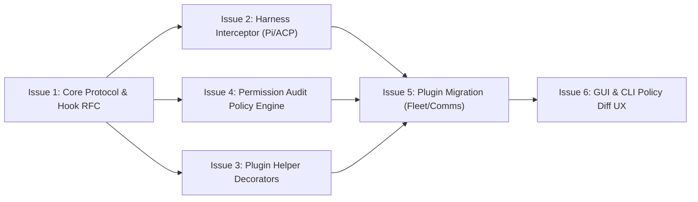

# Granular Security and Permission Gating for MCP Tool Calls

Status: architectural specification / investigation (exploration for #1383)  
Scope: security architecture, MCP permission interception, high-risk operation catalog, declarative policy evaluation, plugin author guidelines, and implementation roadmap.  

This specification is grounded in installed Paseo packages (`@getpaseo/protocol`, `@getpaseo/plugin`, `@getpaseo/server`, `@getpaseo/client`) and this repository (`packages/permission-audit`, `packages/mcp-gateway`, `plugins/mcp-tools`, `plugins/uppidi-fleet`, `plugins/x-comms`). Every claim is cited to exact codebase locations (`path:line`).

> **Note (post-#1493):** the `plugins/permission-logger` citations below were written while that plugin still existed. The functionality they describe now lives entirely in `packages/permission-audit` — the plugin was a thin wrapper over it — so the cited behaviour is unchanged, only the file paths moved.

---

## 1. Problem Statement & Motivation

### 1.1 The Vulnerability of Unstructured Shell Execution

Autonomous agents executing workflows frequently need to inspect state, communicate across hosts, manipulate issue boards, and manage execution lifecycles. Historically, agents invoked command-line utilities (such as `git`, `paseo`, `teax`, `rm`, `curl`, and arbitrary shell scripts) via raw bash or terminal tools (`ToolCallDetail.type = "shell"`, `@getpaseo/protocol/agent-types.d.ts:174-180`).

When an agent executes an operation via a shell string, the Paseo permission interception engine encounters severe structural limitations:

1. **Lack of Parameter Introspection**: A shell command is an unstructured string (e.g. `bash -c "rm -rf .tmp && curl -X POST https://api.internal/reset"`). The daemon receives only `{ type: "shell", command: string }`. To inspect whether the command is harmless (e.g. deleting a temporary file) or catastrophic (e.g. wiping user data or exfiltrating credentials), the security boundary must attempt lexing and parsing shell syntax.
2. **Brittle Heuristic Adjudication**: As demonstrated by `plugins/uppidi-fleet/server/permission-adjudication.ts` (lines 143–402), parsing shell commands safely requires a custom parser to handle balanced subshells (`$(...)`), backtick substitutions (`` `...` ``), quoted heredocs (`<< 'EOF'`), escaped characters, and redirection operators (`>`, `<`). Despite 900+ lines of scanner logic, shell parsing remains fragile: command substitutions, subshells, aliases, environment variable prefixes (`VAR=1 cmd`), path escapes (`..`), and pipe chains (`|`) create bypass avenues or trigger false-positive permission stalls that freeze autonomous orchestrators.
3. **Coarse "All-or-Nothing" Security Posture**: Because shell commands cannot be safely inspected at the parameter level, operators and harness runners resort to running agents in `mode: "yolo"` or `featureValues.auto_accept = true` (`plugins/uppidi-fleet/server/agents.ts:1850-1867`). This completely disables permission prompting, granting the agent unrestricted access to the host operating system, filesystem, network, and daemon socket.

### 1.2 The Structured MCP Advantage

The Model Context Protocol (MCP) formalizes tool invocation as typed, structured RPC messages (`tools/call`) containing:
- A unique tool identifier: `server:tool` or namespaced `tool` (e.g. `x_comms_send`, `fleet_queue_purge`, `pr_merge`).
- A strongly typed, machine-validatable JSON payload adhering to a JSON Schema / Zod schema (`McpToolDefinition.inputSchema`, `packages/mcp-gateway/src/shared/tools.ts:231-236`).
- Structured execution metadata (`ToolCallDetail.type = "unknown"` with `{ input, output }`, or first-class typed details).

Exposing sensitive and remote operations as native MCP tools fundamentally transforms permission evaluation:
- **Type-Safe Parameter Validation**: Arguments such as `repo`, `issueNumber`, `path`, `confirm`, and `timeout` are isolated fields validated by Zod schemas prior to execution.
- **Deterministic Policy Gating**: Security rules evaluate declarative expressions against typed JSON fields (e.g. `path.startsWith(workspace.cwd + "/.tmp/")` or `repo === "xpufx-org/paseo"`), eliminating syntax ambiguities and shell injection risks.
- **Granular Least Privilege**: Low-risk read operations (e.g. `ticket_list`, `fleet_status`, `x_comms_list_daemons`) can be automatically approved without user interruption, while destructive operations (e.g. `pr_merge`, `fleet_queue_purge`, `x_comms_allow_permission`, `kill_agent`) trigger explicit human-in-the-loop (HITL) confirmation modals.

```mermaid
flowchart TD
    subgraph Shell Execution Path (Unsafe)
        A1[Agent prompts bash] --> B1[Raw Shell String: 'rm -rf /path && curl ...']
        B1 --> C1[Complex AST / Shell Scanner: regex & quote heuristics]
        C1 -->|Ambiguous Syntax| D1[Interactive Stall or YOLO Bypass]
    end

    subgraph Structured MCP Tool Path (Safe & Granular)
        A2[Agent invokes MCP Tool] --> B2["Structured Call: 'fleet_queue_purge({ repo: 'paseo', confirm: true })'"]
        B2 --> C2[Zod Schema Validation: Input matches strict contract]
        C2 --> D2[Granular Policy Engine: Evaluates Tool Name, Scope & Arguments]
        D2 -->|Tier 0 / Tier 1 Auto-Approve| E2[Immediate Headless Execution]
        D2 -->|Tier 2 / Tier 3 High-Risk| F2[Paseo Permission Request / Permit UI Modal]
        F2 -->|Human Approves| E2
        F2 -->|Human Denies| G2[Typed Error Returned to Agent]
    end
```

---

## 2. Current Paseo Permission Interception Mechanics

### 2.1 The `AgentPermissionRequest` Protocol Lifecycle

Paseo defines its core permission data structures in `@getpaseo/protocol/agent-types.d.ts` (lines 382–431). When an agent provider requires authorization before executing an action, it emits an `agent_permission_request` stream event:

```typescript
export type AgentPermissionRequestKind = "tool" | "plan" | "question" | "mode" | "other";

export interface AgentPermissionAction {
  id: string;
  label: string;
  behavior: "allow" | "deny";
  variant?: "primary" | "secondary" | "danger";
  intent?: "implement" | "implement_resume" | "dismiss";
}

export interface AgentPermissionRequest {
  id: string;
  provider: AgentProvider;
  name: string;
  kind: AgentPermissionRequestKind;
  title?: string;
  description?: string;
  input?: AgentMetadata;
  detail?: ToolCallDetail;
  suggestions?: AgentPermissionUpdate[];
  actions?: AgentPermissionAction[];
  metadata?: AgentMetadata;
}
```

The resolution is transmitted back from the client or daemon via `AgentPermissionResponse`:

```typescript
export type AgentPermissionResponse =
  | {
      behavior: "allow";
      selectedActionId?: string;
      updatedInput?: AgentMetadata;
      updatedPermissions?: AgentPermissionUpdate[];
    }
  | {
      behavior: "deny";
      selectedActionId?: string;
      message?: string;
      interrupt?: boolean;
    };
```

When an agent requests permission:
1. The daemon records the pending request on the agent snapshot: `agent.pendingPermissions: AgentPermissionRequest[]` (`@getpaseo/cli/.../commands/permit/ls.js:23-28`).
2. The daemon broadcasts `agent_permission_request` to all connected clients and triggers `agent.permission_requested` lifecycle hooks (`@getpaseo/plugin/dist/server/lifecycle.d.ts:55-58`).
3. An approval actor (GUI user, CLI operator via `paseo permit allow`, or automated policy hook) resolves the request by calling `DaemonClient.respondToPermission(agentId, requestId, response)` (`@getpaseo/client/dist/daemon-client.d.ts:1190`).
4. The daemon broadcasts `agent_permission_resolved` (`@getpaseo/protocol/agent-types.d.ts:387-392`) and forwards the decision (`behavior: "allow" | "deny"`) to the provider session loop.

### 2.2 Preapproval Mechanics: `toolPolicy.preapproved` vs Provider Support

`AgentSessionConfig` carries a `toolPolicy` field (`@getpaseo/protocol/agent-types.d.ts:448-450`):

```typescript
export interface McpToolRef {
  kind: "mcp";
  server: string;
  tool: string;
}

export interface ToolPolicy {
  preapproved: McpToolRef[];
}
```

However, unattended preapproval is **not harness-independent**:
- In `@getpaseo/server/.../agent/provider-registry.js` (lines 24–29, 388–398), providers explicitly declare the boolean capability `supportsExactMcpPreapproval`:
  - `claude: { supportsExactMcpPreapproval: true }`
  - `codex: { supportsExactMcpPreapproval: true }`
  - `opencode: { supportsExactMcpPreapproval: true }`
  - `pluginProvider: { supportsExactMcpPreapproval: true }`
  - Other providers (`pi`, `antigravity-acp`, `omniroute`): declare `supportsExactMcpPreapproval: false`.
- If a session is spawned with `toolPolicy` set on a provider that does not declare `supportsExactMcpPreapproval: true`, the daemon throws `ToolPolicyUnsupportedError(provider)` (`provider-registry.js:390-392`).
- Furthermore, `AgentManager` requires that any referenced `server` in `toolPolicy.preapproved` be registered in `AgentSessionConfig.mcpServers` for that session (`agent-manager.js:3646`).

### 2.3 Provider Divergence: The "YOLO" Trap

Because exact tool preapproval is unsupported on `pi` and `antigravity-acp`, fleet runners resort to provider-specific flags during agent initialization:
- `antigravity-acp`: Spawner passes `mode: "yolo"` (`plugins/uppidi-fleet/server/agents.ts:1850`).
- `opencode`: Spawner sets `featureValues.auto_accept = true` (`agents.ts:1867`).
- `pi`: Command approvals default to prompting for any command not present in pi's internal session memory.

This divergence results in a critical gap: either an agent prompts the operator for every trivial read tool, or it runs in full auto-accept/yolo mode with zero interception of dangerous commands.

### 2.4 Daemon Lifecycle Hooks: Observation vs Interception

Paseo plugins register hooks through `PluginServerContext` (`@getpaseo/plugin/dist/server/lifecycle.d.ts:44-94`):
- `PluginLifecycleRegistration.on("agent.permission_requested", (event, context) => ...)`: Event listener that receives `{ agent: PluginHookAgent, request: AgentPermissionRequest }`.
- `PluginLifecycleRegistration.on("agent.permission_resolved", (event, context) => ...)`: Event listener that receives `{ agent: PluginHookAgent, requestId, resolution: AgentPermissionResponse }`.

> [!IMPORTANT]
> `agent.permission_requested` in `@getpaseo/plugin` 0.9.x is an **asynchronous event notification (`on`)**, not a synchronous pre-execution filter (`before`). A plugin cannot directly return an `allow`/`deny` decision from the hook handler itself. Instead, auto-adjudication systems (such as `uppidi-fleet`) must inspect the event and asynchronously invoke `client.respondToPermission(agentId, requestId, resolution)` over the daemon RPC API.

### 2.5 Approval Surfaces: CLI and GUI

1. **CLI (`paseo permit`)**:
   - `paseo permit ls`: Queries `client.fetchAgents()` and collates `agent.pendingPermissions` (`packages/cli/.../commands/permit/ls.js:23-35`).
   - `paseo permit allow <agent> [req_id] [--all] [--input <json>]`: Dispatches `client.respondToPermissionAndWait()` with `behavior: "allow"` and optional parameter overrides (`allow.js:97-114`).
   - `paseo permit deny <agent> [req_id] [--all] [--message <msg>] [--interrupt]`: Dispatches `behavior: "deny"` with an explanation and optional execution termination.
2. **Desktop & Web GUI**:
   - The React client subscribes to WebSocket feed `observeEvents(["agent_permission_request", "agent_permission_resolved"])`.
   - Pending permissions are rendered as modal dialogs or interactive inline timeline cards with colored action buttons (`variant: "primary" | "danger"`) and expandable parameter inspection views.

---

## 3. Destructive & High-Risk Operations Catalog

Across the Paseo ecosystem, multiple plugins and packages provide MCP tools. Below is an exhaustive audit and risk taxonomy classifying these tools into four distinct security tiers:

```
┌────────────────────────────────────────────────────────────────────────┐
│                        MCP Tool Risk Tiers                             │
├─────────┬───────────────────────────────┬──────────────────────────────┤
│ Tier 0  │ Read / Query                  │ Pure idempotent query, auto  │
│ Tier 1  │ Safe Mutations                │ Scoped local changes         │
│ Tier 2  │ Sensitive Remote Comms        │ Cross-daemon prompts/queues  │
│ Tier 3  │ Destructive & Control-Plane   │ PR merge, kill, purge, eval  │
└─────────┴───────────────────────────────┴──────────────────────────────┘
```

### 3.1 Taxonomy of Risk Tiers

| Tier | Category | Operational Impact | Default Policy |
| :--- | :--- | :--- | :--- |
| **Tier 0** | **Read / Query** | Zero side effects. Read-only inspection of status, logs, lists, or diffs. | **Auto-Approved** (unattended) |
| **Tier 1** | **Safe Mutations** | Non-destructive writes within isolated bounds (issue comments, label sync, scratch file cleanup). | **Auto-Approved with Role Checks** |
| **Tier 2** | **Sensitive Remote Comms** | Dispatches prompts or tasks across remote daemons; consumes queue capacity or external API quota. | **Policy-Gated** (allowed if target trusted) |
| **Tier 3** | **Destructive / Control-Plane** | Irreversible changes: merging PRs, killing agents/terminals, purging queues, deleting records, code evaluation. | **Human Approval Mandatory** |

### 3.2 Comprehensive Inventory Across Packages

#### A. `@xpufx/mcp-gateway` (`packages/mcp-gateway/src/shared/tools.ts`)

| Tool Name | Risk Tier | Parameters | Impact & Failure Consequence | Recommended Default |
| :--- | :---: | :--- | :--- | :--- |
| `ticket_list` | **Tier 0** | `directory`, `remoteUrl`, `page` | Read-only issue query. | Auto-approve |
| `ticket_view` | **Tier 0** | `issueNumber`, `directory` | Read-only issue inspection. | Auto-approve |
| `ticket_comment` | **Tier 1** | `issueNumber`, `body` | Posts human-visible comment to issue timeline. | Auto-approve for enrolled repo |
| `ticket_edit` | **Tier 1** | `issueNumber`, `label` | Updates labels (e.g. `state/wip`, `state/review`). | Auto-approve scoped labels |
| `ticket_create` | **Tier 1** | `title`, `body`, `labels` | Creates a new issue thread. | Auto-approve for orchestrator |
| `pr_list` | **Tier 0** | `state`, `author`, `branch` | Read-only PR query. | Auto-approve |
| `pr_view` | **Tier 0** | `pullRequestNumber` | Read-only PR inspection. | Auto-approve |
| `pr_diff` | **Tier 0** | `pullRequestNumber` | Read-only raw patch retrieval. | Auto-approve |
| `pr_create` | **Tier 1** | `title`, `body`, `headBranch`, `baseBranch` | Opens a new pull request targeting `main`. | Auto-approve for workers |
| `pr_merge` | **Tier 3** | `pullRequestNumber`, `squash`, `commitMsg` | **Destructive**: Merges code directly to `main` branch. Bypasses human CI signoff if unguarded. | **Human Confirmation Required** |
| `ci_logs` | **Tier 0** | `runId`, `stepId`, `page` | Read-only action run logs. | Auto-approve |

#### B. `plugins/uppidi-fleet` (`plugins/uppidi-fleet/server/mcp-tools.ts`)

| Tool Name | Risk Tier | Parameters | Impact & Failure Consequence | Recommended Default |
| :--- | :---: | :--- | :--- | :--- |
| `fleet_check_board` | **Tier 0** | `repo`, `hostname`, `role`, `stage` | Read-only candidate triage and scoring. | Auto-approve |
| `fleet_watchdog_audit` | **Tier 0/1** | `recover`, `frontDeskId`, `steerMessage` | Health audit. If `recover: true`, wakes/steers stalled agents. | Auto-approve (audit); Tier 1 (recover) |
| `fleet_queue_inspect` | **Tier 0** | `repo` | Read-only inspection of webhook queues. | Auto-approve |
| `fleet_handoff_generate`| **Tier 0** | `json` | Generates summary markdown report of fleet status. | Auto-approve |
| `fleet_validate_workspace`| **Tier 0** | `path`, `workspaceId` | Read-only path / git worktree verification. | Auto-approve |
| `fleet_board_sweep` | **Tier 1** | `repos`, `stage`, `profile` | Sweeps repos and transitions stage labels on board. | Auto-approve for orchestrator |
| `fleet_prune_orchestrators`| **Tier 1** | `dryRun` | Removes stale orchestrator metadata files from disk. | Auto-approve for orchestrator |
| `fleet_ensure_orchestrator`| **Tier 2** | `repo`, `mode`, `provider`, `force` | Spawns a long-running agent process on the daemon. | Gated: Role check (Front Desk only) |
| `fleet_rotate_role` | **Tier 3** | `role`, `repo`, `reason` | **Destructive**: Archives incumbent agent and spawns replacement. Disconnects active sessions. | **Human / Orchestrator Gated** |
| `fleet_queue_purge` | **Tier 3** | `repo`, `confirm` | **Destructive**: Drops all buffered webhook events and queue files permanently. Data loss. | **Human Confirmation Required** |
| `fleet_prune_dead_sessions`| **Tier 3** | `dryRun`, `apply`, `kill` | **Destructive**: If `kill: true`, terminates daemon agent processes via `agent delete`. | **Human Confirmation Required** |

#### C. `plugins/x-comms` (`plugins/x-comms/docs/contract-mcp.md:62-225`)

| Tool Name | Risk Tier | Parameters | Impact & Failure Consequence | Recommended Default |
| :--- | :---: | :--- | :--- | :--- |
| `x_comms_list_daemons` | **Tier 0** | `detailed` | Lists registered peer host aliases. | Auto-approve |
| `x_comms_list_agents` | **Tier 0** | `daemon` | Queries remote agent roster. | Auto-approve |
| `x_comms_inspect` | **Tier 0** | `daemon`, `agentId` | Queries remote agent status and timeline cursor. | Auto-approve |
| `x_comms_logs` | **Tier 0** | `daemon`, `agentId` | Retrieves remote agent timeline logs. | Auto-approve |
| `x_comms_wait` | **Tier 0** | `daemon`, `agentId`, `timeoutSeconds` | Awaits remote agent turn completion. | Auto-approve |
| `x_comms_list_permissions`| **Tier 0** | `daemon` | Lists pending permission requests on remote host. | Auto-approve |
| `x_comms_add_daemon` | **Tier 1** | `name`, `offer` | Adds peer endpoint mapping to local in-memory pool. | Auto-approve |
| `x_comms_remove_daemon`| **Tier 1** | `name` | Evicts peer connection from in-memory pool. | Auto-approve |
| `x_comms_send` | **Tier 2** | `daemon`, `agentId`, `prompt`, `notifyOnFinish` | **Sensitive Remote Comms**: Injects prompt into remote agent, starting turns or consuming token quota. | Gated: Match against trusted peer list |
| `x_comms_allow_permission`| **Tier 3** | `daemon`, `agentId`, `reqId`, `all`, `input` | **Control-Plane**: Authorizes tool calls on a remote host without local operator oversight. | **Human Confirmation Required** |
| `x_comms_deny_permission`| **Tier 3** | `daemon`, `agentId`, `reqId`, `all`, `message` | **Control-Plane**: Rejects tool call and can interrupt remote agent turns. | **Human Confirmation Required** |

#### D. Paseo Built-in Host MCP (`@getpaseo/server/.../agent/tools/paseo-tools.js:829-2347`)

| Tool Name | Risk Tier | Operational Impact | Recommended Default |
| :--- | :---: | :--- | :--- |
| `list_workspaces`, `list_agents`, `get_agent_status`, `list_terminals`, `list_schedules`, `list_providers`, `list_models`, `list_pending_permissions` | **Tier 0** | Read-only inspection of daemon host control-plane. | Auto-approve |
| `browser_screenshot`, `browser_logs` | **Tier 0** | Read-only inspection of headless browser tab. | Auto-approve |
| `create_workspace`, `rename_workspace` | **Tier 1** | Creates workspace worktrees or updates project names. | Auto-approve for orchestrator |
| `create_schedule`, `create_heartbeat` | **Tier 1** | Registers recurring cron triggers in daemon storage. | Auto-approve with quota checks |
| `browser_select`, `browser_scroll`, `browser_drag` | **Tier 1** | Benign DOM interactions on active test browser. | Auto-approve |
| `send_agent_prompt` | **Tier 2** | Injects prompt into local sibling agent turn. | Auto-approve for fleet peers |
| `archive_workspace` | **Tier 3** | Deletes workspace files or git worktrees from disk. | **Human Confirmation Required** |
| `cancel_agent`, `archive_agent`, `kill_agent` | **Tier 3** | Terminates agent processes and deletes session records. | **Human Confirmation Required** |
| `create_terminal`, `kill_terminal`, `send_terminal_keys` | **Tier 3** | Opens pseudo-terminals and sends raw keystrokes to shell. | **Human Confirmation Required** |
| `browser_evaluate`, `browser_upload` | **Tier 3** | Executes arbitrary JavaScript in browser context; uploads files. | **Human Confirmation Required** |
| `respond_to_permission` | **Tier 3** | Approves or denies pending permissions on the daemon. | **Human Confirmation Required** |

---

## 4. Policy Configuration Schema & Evaluation Engine

To replace ad-hoc shell classifiers with deterministic, verifiable security boundaries, Paseo requires a formal policy configuration schema and a centralized evaluation engine.

### 4.1 Declarative Policy Schema

The policy schema defines rules mapped to tool names or namespaces. Each rule specifies parameter constraints, role restrictions, and the adjudication verdict (`allow`, `deny`, or `prompt`):

```typescript
import { z } from "zod";

export const ParameterConstraintSchema = z.discriminatedUnion("type", [
  z.object({
    type: z.literal("string_regex"),
    field: z.string(),
    pattern: z.string(),
  }),
  z.object({
    type: z.literal("string_in"),
    field: z.string(),
    allowedValues: z.array(z.string()),
  }),
  z.object({
    type: z.literal("path_within"),
    field: z.string(),
    within: z.enum(["workspace_root", "scratch_tmp", "agent_cwd"]),
  }),
  z.object({
    type: z.literal("boolean_equals"),
    field: z.string(),
    value: z.boolean(),
  }),
  z.object({
    type: z.literal("number_max"),
    field: z.string(),
    max: z.number(),
  }),
]);

export const PolicyVerdictSchema = z.enum(["allow", "deny", "prompt"]);

export const ToolPolicyRuleSchema = z.object({
  id: z.string().min(1),
  description: z.string().optional(),
  tool: z.string().min(1), // e.g. "x_comms_send", "fleet_*", "pr_merge"
  roles: z.array(z.string()).optional(), // e.g. ["orchestrator", "front-desk"]
  constraints: z.array(ParameterConstraintSchema).default([]),
  verdict: PolicyVerdictSchema,
  message: z.string().optional(),
});

export const McpSecurityPolicyConfigSchema = z.object({
  version: z.literal(1),
  defaultVerdict: PolicyVerdictSchema.default("prompt"),
  trustedDaemons: z.array(z.string()).default([]),
  enrolledRepos: z.array(z.string()).default([]),
  rules: z.array(ToolPolicyRuleSchema).default([]),
});

export type McpSecurityPolicyConfig = z.infer<typeof McpSecurityPolicyConfigSchema>;
```

### 4.2 Parameter-Level Pattern Matching Mechanics

The policy engine evaluates constraints strictly against the typed `AgentPermissionRequest.input` payload:

1. **Path Containment (`path_within`)**:
   - `scratch_tmp`: Asserts the path resolves strictly inside `<workspace>/.tmp/` without `..` directory traversal escapes.
   - `workspace_root`: Asserts the path resolves within the assigned Git worktree directory.
2. **Repository Scope (`string_in` / `string_regex`)**:
   - Asserts `repo` matches the configured `enrolledRepos` list (e.g. `["xpufx-org/paseo"]`).
3. **Peer Daemon Trust (`trustedDaemons`)**:
   - For `x_comms_send`, verifies `daemon` matches an enrolled peer daemon alias, preventing unauthorized cross-network prompt injections.
4. **Safety Confirmation Flags (`boolean_equals`)**:
   - For destructive tools like `fleet_queue_purge`, requires `confirm === true` as a prerequisite before prompting the operator.

### 4.3 Session Preapproval Caching & Leases

To maintain agent throughput without compromising security:
- **Temporal Leases**: When a human operator approves an action in the GUI or CLI (e.g. `paseo permit allow`), they can grant a session lease (e.g. "Allow `ticket_comment` on issue #1383 for 2 hours").
- **Invocation Quotas**: High-impact Tier 2 operations can declare an invocation budget (e.g. maximum 10 `x_comms_send` calls per turn).
- **Idempotency Tokens (`messageId`)**: Repeat invocations carrying the same `messageId` (such as delivery retries) are matched against cached receipts rather than triggering duplicate approval prompts.

### 4.4 Role-Based Tool Matrix

Different fleet agent classes require distinct capability envelopes:

```
┌─────────────────────────┬────────────┬──────────────┬────────┬─────────┐
│ Tool Group              │ Front Desk │ Orchestrator │ Worker │ Auditor │
├─────────────────────────┼────────────┼──────────────┼────────┼─────────┤
│ Tier 0 (Read / Triage)  │     ✅     │      ✅      │   ✅   │   ✅    │
│ Tier 1 (Board/Comments) │     ✅     │      ✅      │   ✅   │   ❌    │
│ Tier 2 (Fleet Control)  │     ✅     │      ✅      │   ❌   │   ❌    │
│ Tier 3 (Destructive/PR) │    Prompt  │    Prompt    │   ❌   │   ❌    │
└─────────────────────────┴────────────┴──────────────┴────────┴─────────┘
```

- **Front Desk**: Requires broad read access (`fleet_check_board`, `ticket_list`, `x_comms_list_daemons`), safe triage comments (`ticket_comment`), and ability to ensure/wake orchestrators (`fleet_ensure_orchestrator`).
- **Orchestrator**: Full management authority over enrolled repositories, board transitions (`fleet_board_sweep`), and PR review (`pr_view`, `pr_diff`). Destructive operations (`pr_merge`, `fleet_queue_purge`) escalate for human confirmation.
- **Worker / Coding Agent**: Narrow workspace-scoped access (`fleet_validate_workspace`, `pr_create`, `ticket_view`). Strictly blocked from control-plane, cross-daemon comms, and merging.
- **Auditor**: Pure read-only inspection (`fleet_watchdog_audit`, `ci_logs`, `permission-audit.query`). Zero mutation privileges.

---

## 5. Design Guidelines for Plugin Authors

When implementing native MCP tools in Paseo plugins, authors must adhere to the following architectural invariants to ensure compatibility with granular permission gating:

### 5.1 Semantic Tool Naming & Verbs

Tools must use explicit semantic naming reflecting their risk category:
- **Tier 0 (Read)**: Prefix with `get_`, `list_`, `inspect_`, `view_`, `check_`, `validate_`, or `search_`.
- **Tier 1 (Benign Mutation)**: Prefix with `create_`, `update_`, `comment_`, `add_`, or `set_`.
- **Tier 2 (Remote/Async)**: Prefix with `send_`, `dispatch_`, `route_`, or `enqueue_`.
- **Tier 3 (Destructive)**: Prefix with `delete_`, `purge_`, `kill_`, `prune_`, `archive_`, `merge_`, or `reset_`.

### 5.2 Strict Input Schema Design

- Every tool must define a Zod schema with `.strict()` or `additionalProperties: false`.
- Avoid untyped string bags or raw JSON fields (`z.record(z.unknown())`).
- Use discriminated unions for polymorphic payloads.
- Any tool performing destructive modifications **must** include an explicit `confirm: z.boolean()` property in its schema.

### 5.3 Explicit Risk & Idempotency Annotations

Tools must export machine-readable risk metadata in their definitions:

```typescript
export interface PaseoMcpToolMetadata {
  name: string;
  description: string;
  riskTier: 0 | 1 | 2 | 3;
  destructive: boolean;
  idempotent: boolean;
  requiredRole?: "front-desk" | "orchestrator" | "worker";
}
```

### 5.4 Idempotency & Replay Protection

- Mutating tools must accept an optional `idempotencyKey` or `messageId` (`z.string().uuid().optional()`).
- Invocations must verify whether an operation has already executed before re-applying side effects.
- If a turn retry occurs, the tool must return the previously cached outcome rather than failing or duplicating actions.

### 5.5 Graceful Error Handling (Never Throw on Wire)

- Tool handlers must **never throw uncaught exceptions** into the stdio or SSE transport. A thrown exception terminates the MCP process or drops the JSON-RPC connection.
- Expected failures (e.g. invalid arguments, unconfirmed purges, target busy, network timeout) must return structured `{ isError: true, content: [{ type: "text", text: errorMessage }] }`.

### 5.6 Anti-Fallback Invariant: Prohibit Shell Fallbacks

- Plugin tools must **never** fall back to executing shell subprocesses (`execFile("bash", ...)`, `exec("sh", ...)`, or CLI commands) when a native SDK or RPC endpoint exists.
- In `plugins/x-comms`, replacing `execFile("paseo", ["send", ...])` with direct `@getpaseo/client` `DaemonClient.sendAgentPrompt()` eliminated shell escaping vulnerabilities and child process overhead. All future plugins must follow this pattern.

---

## 6. Actionable Implementation Roadmap

To transition Paseo from heuristic shell adjudication to first-class granular MCP permission gating, the following concrete engineering issues are prioritized:



### Issue 1: Upstream RFC — Parameter-Aware `ToolPolicy` and `before("agent.permission_requested")` Hook
- **Scope**: Core daemon & SDK (`@getpaseo/protocol`, `@getpaseo/server`, `@getpaseo/plugin`).
- **Deliverables**:
  1. Extend `AgentSessionConfig.toolPolicy` to admit parameter-constrained rules (`McpToolRule: { server, tool, constraints? }`) in addition to bare `McpToolRef`.
  2. Promote `agent.permission_requested` from an event-only listener (`PluginLifecycleEvents`) to a pre-decision interceptor hook (`PluginBeforeRequests["agent.permission_requested"]`).
  3. Allow plugins to return an authoritative `{ decision: "allow" | "deny" | "defer", updatedInput? }` directly from the hook, removing the need for out-of-band `respondToPermission` RPC calls.

### Issue 2: Universal MCP Tool Interceptor for Non-Claude Harnesses (`pi` and `acp`)
- **Scope**: `@getpaseo/server/.../providers/`.
- **Deliverables**:
  1. Decouple exact MCP preapproval from `supportsExactMcpPreapproval` provider flags.
  2. Implement a daemon-level tool proxy layer that wraps MCP server calls before forwarding them to `acp-agent` or `pi`.
  3. Ensure non-Claude agents can run in interactive mode without triggering false-positive prompts for Tier 0/Tier 1 MCP tools, eliminating the necessity of coarse `yolo` modes.

### Issue 3: Plugin Helper Risk Annotation & `defineMcpTool` Contract
- **Scope**: `packages/paseo-plugin-helper/src/server/mcp/`.
- **Deliverables**:
  1. Provide a typed helper `defineMcpTool({ name, riskTier, inputSchema, outputSchema, handler })`.
  2. Automatically generate MCP `Tool` definitions with standardized annotations (`riskTier: 0..3`, `destructive: boolean`).
  3. Inject standard `confirm: boolean` validation for any tool tagged `destructive: true`.

### Issue 4: Declarative MCP Policy Engine in `packages/permission-audit`
- **Scope**: `packages/permission-audit/src/`.
- **Deliverables**:
  1. Implement `McpPolicyEngine` evaluating `McpSecurityPolicyConfigSchema` against `AgentPermissionRequest`.
  2. Implement path validators (`path_within`), repo allowlists, and peer server checks.
  3. Integrate with `PermissionLogStore` to record whether a tool was auto-approved by policy, allowed by lease, or approved by human interaction.

### Issue 5: Migrate Fleet & Comms Adjudication from Shell to Native MCP
- **Scope**: `plugins/uppidi-fleet/server/permission-adjudication.ts` and `plugins/x-comms`.
- **Deliverables**:
  1. Refactor `permission-adjudication.ts`: replace the 500-line shell command scanner with structured pattern matching against `RawPermissionLike.input`.
  2. Add granular policy checks for `x_comms_send` (enrolled host verification) and `x_comms_allow_permission` (strict human gating).
  3. Mark `pr_merge`, `fleet_queue_purge`, and `fleet_prune_dead_sessions` as Tier 3 requiring human confirmation.

### Issue 6: Enhanced GUI & CLI Approval UX for Structured MCP Tools
- **Scope**: `@getpaseo/cli` and `packages/paseo-plugin-ui`.
- **Deliverables**:
  1. Update `paseo permit ls` to display structured tool parameters (`TOOL`, `ARGS_PREVIEW`, `TIER`) instead of raw shell strings.
  2. Implement parameter diffing in the Paseo Desktop/Web permission dialog when `updatedInput` is provided.
  3. Add a "Remember this rule" button in the GUI permission prompt that automatically appends a scoped auto-approval rule to `settings.json`.

---

## 7. Primary References

- Paseo Protocol Agent Types: `@getpaseo/protocol/agent-types.d.ts:382-450`
- Paseo Lifecycle Hook Definitions: `@getpaseo/plugin/dist/server/lifecycle.d.ts:44-94`
- Provider Registry Preapproval Capabilities: `@getpaseo/server/.../agent/provider-registry.js:24-29,388-398`
- Paseo Built-in Host Tools: `@getpaseo/server/.../agent/tools/paseo-tools.js:829-2347`
- MCP Agent Injection Design Precedent: `docs/mcp-agent-injection.md`
- Permission Logger & Audit Store: `packages/permission-audit/src/server.ts:1-712`
- Shell Permission Adjudication Engine: `plugins/uppidi-fleet/server/permission-adjudication.ts:1-800`
- Fleet MCP Tool Definitions: `plugins/uppidi-fleet/server/mcp-tools.ts:40-388`
- MCP Gateway Tool Schemas: `packages/mcp-gateway/src/shared/tools.ts:1-543`
- x-comms MCP Features Contract: `plugins/x-comms/docs/contract-mcp.md:62-225`
