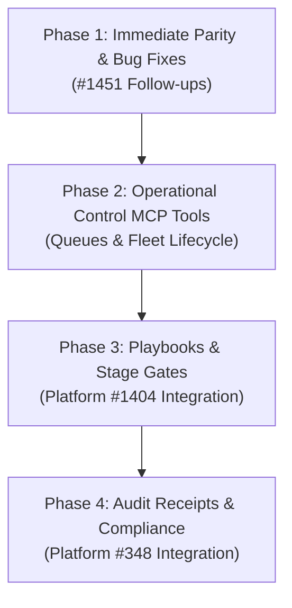

# Uppidi Fleet: MCP Tools vs Daemon HTTP API & Router Capabilities Gap Analysis

**Document Status**: Ratified Analysis & Architecture Specification  
**Issue Reference**: [Issue #1451 (forge.mrs)](https://forge.mrs.uppidi.com/xpufx-org/paseo/issues/1451), Refs [#1415](https://forge.mrs.uppidi.com/xpufx-org/paseo/issues/1415)  
**Date**: 2026-10-19  
**Scope**: `plugins/uppidi-fleet` daemon HTTP API routes, RPC contracts, router engine capabilities, `FLEET_MCP_TOOLS` schema declarations, and Cockpit Tooling view form rendering.

---

## 1. Executive Summary

### 1.1 Context & Background
During the pre-flight audit for Issue #1415, human operator `@okcode` identified a systemic architectural divergence across the `plugins/uppidi-fleet` control plane: capabilities and configuration parameters were frequently implemented on daemon HTTP routes, RPC handlers, and internal engine methods without corresponding exposure in `FLEET_MCP_TOOLS` schema definitions. While #1415 resolved schema parity specifically for board sweep decision traces and diagnostic comment options (`trace`, `diagnosticComment`), a full system audit was commissioned under Issue #1451 to evaluate the entire surface area.

### 1.2 Problem Statement
Paseo autonomous agents (including Front Desk, Orchestrator, and Coding Agents) and human operators interacting via MCP tools or the Cockpit UI (`UppidiFleetToolingView`) rely on `inputSchema` declarations in `plugins/uppidi-fleet/server/mcp-tools.ts` (`FLEET_MCP_TOOLS`) as their authoritative contract. When router methods and HTTP endpoints accept flags or provide capabilities that are omitted from `FLEET_MCP_TOOLS`:
1. **Agent Tool Blindness**: Autonomous models cannot discover or invoke critical operational switches (e.g. queue pausing/resuming, audit receipt checking, stage gate evaluation, watchdog thresholds).
2. **Cockpit UI Truncation**: The schema-driven dynamic runner in `UppidiFleetToolingView` cannot render input fields for undeclared properties, forcing operators into manual CLI or HTTP curl commands.
3. **Execution Divergence & Incomplete Stubs**: Certain MCP execution wrappers (e.g. `executeFleetPruneDeadSessions`) declare options like `apply` and `kill`, but only execute simulation logic without calling underlying deletion primitives, creating a false sense of actuation.

### 1.3 Architectural Importance of Schema Parity
Per the Canonical Control-Plane Doctrine ([platform#337](https://forge.mrs.uppidi.com/xpufx-org/platform/issues/337), [platform#396](https://forge.mrs.uppidi.com/xpufx-org/platform/issues/396)), desired vs. observed state must remain clean, predictable, and typed. MCP schemas represent the primary machine-readable API boundary between autonomous LLM agents and the fleet runtime. Maintaining strict bidirectional parity between daemon HTTP/RPC endpoints and MCP schemas guarantees deterministic tool call behavior, comprehensive UI observability, and reliable agent self-healing across the fleet.

---

## 2. Comprehensive HTTP Routes vs MCP Tools Matrix

The `HookRouter` HTTP server in `plugins/uppidi-fleet/server/hook-router.ts` exposes 35 HTTP route handlers in `handleHttpRequest`. The table below maps each HTTP route to its corresponding MCP tool in `FLEET_MCP_TOOLS`, identifying missing tool coverage, parameter differences, and operational purpose.

| HTTP Method & Route | Handled Purpose | Existing MCP Tool | Coverage Status | Parameter & Schema Gaps |
| :--- | :--- | :--- | :--- | :--- |
| `GET /health` | Health check, uptime, bound port, and service status | None | **Missing Tool** | No MCP tool exposes basic daemon HTTP/router health or service heartbeat. |
| `GET /status` | Comprehensive status overview (`mode`, `halted`, `frontDesk`, `queues`, `totalQueued`, `capabilities`) | None | **Missing Tool** | Missing `fleet_status_get`. Agents currently have no MCP tool to query fleet lifecycle mode or global halt status. |
| `GET /enrolled`<br>`GET /repos/enrolled` | Returns canonical enrolled repository list and count | None | **Missing Tool** | Missing `fleet_enrolled_repos`. Autonomous agents cannot query currently enrolled repositories via MCP without sweeping. |
| `GET /info` | Router host, port, URL, Front Desk ID, registered repo keys | None | **Missing Tool** | Informational; overlaps with `GET /status` and `uppidiHookInfoContract`. |
| `GET /queues` | Overview of all webhook queues, depth, paused states, orchestrators | `fleet_queue_inspect` | **Full Coverage** | MCP tool wraps `inspectQueues()` which projects `getQueuesOverview()`. |
| `GET /frontdesk` | Reads current Front Desk agent ID record | None | **Partial Coverage** | Missing dedicated query tool. Overlapped by `GET /status` and `fleet_watchdog_audit`. |
| `POST /frontdesk` | Registers existing `agentId` as Front Desk, retires previous, delivers stand-down, drains queue | None | **Missing Tool** | `fleet_rotate_role` respawns/rotates, but no MCP tool allows binding an *already running* agent as Front Desk. |
| `GET /frontdesk-handoff`<br>`GET /handoff` | Returns latest handoff report status | None | **Partial Coverage** | Missing read tool. Agents must generate a fresh handoff with `fleet_handoff_generate` to read. |
| `POST /frontdesk-handoff`<br>`POST /handoff` | Delivers handoff text/file to Front Desk agent session | None | **Missing Tool** | Missing `fleet_handoff_deliver`. HTTP accepts `{ agentId, handoffText, handoffFile }`; MCP can only generate markdown. |
| `POST /frontdesk-handoff/generate`<br>`POST /handoff/generate` | Generates latest shift handoff markdown across enrolled repos | `fleet_handoff_generate` | **Full Coverage** | Returns markdown report or JSON payload. |
| `POST /orchestrator-rotate` | Rotates a long-lived role (`orchestrator`, `front-desk`, `auditor`, `coding-agent`) | `fleet_rotate_role` | **Full Coverage** | MCP exposes `role`, `repo`, `reason`, `json`. Note: MCP hardcodes `force: true`; HTTP accepts `force?: boolean`. |
| `GET /orchestrator-rotation` | Queries rotation state, cooldown, triggers, and brief path | None | **Missing Tool** | Missing `fleet_rotation_status`. Agents cannot query whether a role is eligible for rotation without triggering it. |
| `GET /rotation-policy` | Returns persisted rotation policy for all roles | None | **Missing Tool** | Missing `fleet_rotation_policy_get`. |
| `POST /rotation-policy` | Sets/updates rotation policy thresholds for a role/repo | None | **Missing Tool** | Missing `fleet_rotation_policy_set`. Requires `{ role, repo?, policy }`. |
| `POST /orchestrators/prune` | Audits and prunes dead orchestrator records from disk registry | `fleet_prune_orchestrators` | **Full Coverage** | MCP tool supports `dryRun`, whereas HTTP route invokes `pruneOrchestrators()` unconditionally without body parsing. |
| `POST /board-sweep` | Multi-repo board sweep, evaluates issues, prunes, alerts Front Desk | `fleet_board_sweep` | **Full Coverage** | Parameter divergence: HTTP accepts JSON array `repos: string[]`; MCP accepts comma-separated string `repos: string`. MCP supports `trace` and `diagnosticComment`. |
| `GET /board/sweep` | Single-repo issues check and triage ranking | `fleet_check_board` | **Full Coverage** | Parity achieved in #1415 (`trace`, `diagnosticComment`, `stage`, `profile`). HTTP supports `format=markdown\|json`, MCP uses `json: boolean`. Missing `sweepStaleWip` in MCP. |
| `GET /orchestrators`<br>`GET /orchestrators/:repo` | Lists registered orchestrator records or inspects specific repo | None | **Missing Tool** | Missing `fleet_orchestrators_list`. Agents cannot inspect orchestrator registry entries via MCP. |
| `POST /orchestrators/spawn` | Ensures an active orchestrator exists for a repo | `fleet_ensure_orchestrator` | **Full Coverage** | Exposes `repo`, `provider`, `model`, `mode`, `force`, `json`. |
| `POST /orchestrator`<br>`POST /orchestrate` | Registers an *existing* `agentId` as orchestrator for a repo | None | **Missing Tool** | `fleet_ensure_orchestrator` spawns/ensures; no MCP tool manually binds an existing agent ID to a repo without spawning. |
| `POST /agents/spawn` | Unified agent spawn entry point (`frontdesk`, `orchestrator`, `worker`) | None | **Missing Tool** | Missing `fleet_agent_spawn`. No generic spawn tool in MCP; only orchestrators can be ensured via `fleet_ensure_orchestrator`. |
| `POST /frontdesk/spawn` | Dedicated Front Desk agent spawn endpoint | None | **Missing Tool** | Missing `fleet_frontdesk_spawn`. Currently done via RPC or CLI `scripts/spawn-frontdesk.sh`. |
| `POST /workers/spawn` | Dedicated worker spawn with skill directive and labels | None | **Missing Tool** | Missing `fleet_worker_spawn`. Worktree validation exists (`fleet_validate_workspace`), but actual spawn has no MCP tool. |
| `POST /queues/:key/pause`<br>`POST /queue/pause` | Pauses webhook event delivery for a specific repo queue or all | None | **Missing Tool** | Missing `fleet_queue_pause`. Agents cannot pause queues via MCP during emergencies or maintenance. |
| `POST /queues/:key/resume`<br>`POST /queue/resume` | Resumes webhook event delivery for a specific repo queue or all | None | **Missing Tool** | Missing `fleet_queue_resume`. Agents cannot resume paused queues via MCP. |
| `POST /queues/:key/drain`<br>`POST /queue/drain` | Triggers immediate queue drain delivery to orchestrator | None | **Missing Tool** | Missing `fleet_queue_drain`. Agents cannot trigger manual queue flushing via MCP. |
| `POST /queues/:key/purge`<br>`POST /queue/purge` | Purges buffered webhook messages for a specific queue | `fleet_queue_purge` | **Full Coverage** | MCP tool enforces explicit safety confirmation `confirm: true`. |
| `POST /audits` | Appends a signed audit receipt to the durable JSONL log | None | **Missing Tool** | Missing `fleet_audit_record`. Crucial for autonomous verification and compliance agents ([Platform#348](https://forge.mrs.uppidi.com/xpufx-org/platform/issues/348)). |
| `GET /audits/check` | Validates audit receipt existence for `repo`, `pr`, `commit` | None | **Missing Tool** | Missing `fleet_audit_check`. Orchestrators cannot verify PR audit signoff through MCP before merging. |
| `GET /audits/summary` | Projects audit receipt summary and metrics | None | **Missing Tool** | Missing `fleet_audit_summary`. |
| `POST /stage/evaluate` | Evaluates playbook stage transition rules and human gates | None | **Missing Tool** | Missing `fleet_stage_evaluate` (#1404). Agents cannot query transition validity through MCP. |
| `POST /stage/transition` | Executes stage transition guard and applies labels | None | **Missing Tool** | Missing `fleet_stage_transition` (#1404). |
| `GET /stage/human-gates` | Lists active human operator gates blocking automated progression | None | **Missing Tool** | Missing `fleet_stage_human_gates` (#1404). |
| `GET /stage/metrics`<br>`/playbook/metrics` | Reports playbook transition latency, attempts, and rejection metrics | None | **Missing Tool** | Missing `fleet_stage_metrics` (#1404). |
| `POST /forgejo`<br>`POST /hook` | Ingress webhook receiver for Forgejo events | N/A | **Excluded (by design)** | External webhook receiver only. External webhooks must enter via HTTP ingress, not agent tool execution. |

---

## 3. RPC Contracts vs MCP Tools Matrix

The Paseo plugin server (`plugins/uppidi-fleet/index.server.ts` and `plugins/uppidi-fleet/shared/contracts.ts`) defines 48 RPC contracts. These fall into two distinct architectural categories:
1. **Internal Client UI Surface**: Exclusively consumed by the Cockpit UI (Kanban board, log tailing, UI settings, telemetry viewer).
2. **Agent / System Boundary**: Operational capabilities that should be accessible to autonomous agents via MCP tools.

| RPC Contract Name | Handler Function | Intended Boundary | MCP Tool Equivalent | Parity & Design Recommendation |
| :--- | :--- | :--- | :--- | :--- |
| `uppidiIssuesContract` | `handleUppidiIssues` | Internal Client UI | `fleet_check_board` | UI reads issue board via RPC; agents use `fleet_check_board` or `teax`. Clean boundary. |
| `uppidiTransitionIssueContract` | `handleUppidiTransitionIssue` | Internal Client UI | None | Used for drag-and-drop in UI Kanban board. Agents use `teax issue edit` or stage transition APIs. |
| `uppidiHookStatusContract` | `handleHookStatus` | Agent / System | None (**Gap**) | Client UI consumes this for header status; agents lack an equivalent `fleet_status_get` tool. |
| `uppidiHookInfoContract` | `handleHookInfo` | Internal Client UI | None | Connection discovery for client UI. |
| `uppidiHookQueuesContract` | `handleHookQueues` | Agent / System | `fleet_queue_inspect` | Full functional parity via `fleet_queue_inspect`. |
| `uppidiHookPauseContract` | `handleHookPause` | Agent / System | None (**Gap**) | UI can pause queues; agents cannot pause queues via MCP. |
| `uppidiHookResumeContract` | `handleHookResume` | Agent / System | None (**Gap**) | UI can resume queues; agents cannot resume queues via MCP. |
| `uppidiHookDrainContract` | `handleHookDrain` | Agent / System | None (**Gap**) | UI can trigger drain; agents cannot trigger drain via MCP. |
| `uppidiHookServiceStatusContract` | `handleHookServiceStatus` | Internal Client UI | None | Systemd/process daemon status for UI. |
| `uppidiHookServiceActionContract` | `handleHookServiceAction` | Internal Client UI | None | Start/stop/restart hook daemon from UI. |
| `uppidiHookConfigureContract` | `handleHookConfigure` | Internal Client UI | None | Host/port reconfiguration from UI. |
| `uppidiHookLogTailContract` | `handleHookLogTail` | Internal Client UI | None | Streaming daemon logs in Cockpit UI. |
| `fleetRosterContract` | `handleUppidiAgents` | Internal Client UI | None | UI roster list. Agents inspect health via `fleet_watchdog_audit`. |
| `uppidiRoleModelsContract`<br>`uppidiSetRoleModelContract` | `handleUppidiRoleModels`<br>`handleUppidiSetRoleModel` | Internal Client UI | None | Role model configurations (e.g. Gemini flash vs pro). Desired configuration. |
| `uppidiFleetAlertsContract` | `handleUppidiFleetAlerts` | Agent / System | `fleet_watchdog_audit` | Overlapped by `fleet_watchdog_audit`. |
| `uppidiSkillsContract`<br>`uppidiSetSkillContract` | `handleUppidiSkills`<br>`handleUppidiSetSkill` | Internal Client UI | None | Skill management in Cockpit UI. |
| `uppidiRunnersContract`<br>`uppidiFleetScaleHostContract`<br>`uppidiFleetDrainHostContract` | `handleUppidiRunners`<br>`handleUppidiFleetScaleHost`<br>`handleUppidiFleetDrainHost` | Agent / System | None (**Gap**) | Forgejo Actions runner scaling and drain. High-level infrastructure control. |
| `uppidiFleetMetricsContract` | `handleUppidiFleetMetrics` | Internal Client UI | None | Telemetry charts in UI. |
| `uppidiModelTelemetryQueryContract` | `handleUppidiModelTelemetryQuery` | Internal Client UI | None | Token and cost usage metrics. |
| `uppidiArchiveAgentContract`<br>`uppidiArchiveInactiveAgentsContract` | `handleUppidiArchiveAgent`<br>`handleUppidiArchiveInactiveAgents` | Agent / System | `fleet_prune_dead_sessions` | Agents use `fleet_prune_dead_sessions` and `fleet_prune_orchestrators`. |
| `uppidiCreateFrontDeskContract`<br>`uppidiReplaceFrontDeskContract` | `handleUppidiCreateFrontDesk`<br>`handleUppidiReplaceFrontDesk` | Agent / System | `fleet_rotate_role` | UI buttons trigger creation/replacement; agents rotate via `fleet_rotate_role`. |
| `uppidiAddOrchestratorContract`<br>`uppidiReplaceOrchestratorContract` | `handleUppidiAddOrchestrator`<br>`handleUppidiReplaceOrchestrator` | Agent / System | `fleet_ensure_orchestrator`<br>`fleet_rotate_role` | Covered by `fleet_ensure_orchestrator` and `fleet_rotate_role`. |
| `uppidiToggleRepoPauseContract`<br>`uppidiToggleRepoAutomationTierContract` | `handleUppidiToggleRepoPause`<br>`handleUppidiToggleRepoAutomationTier` | Agent / System | None (**Gap**) | UI toggles repo automation tier (`autonomous`, `semi`, `kanban-only`); agents have no MCP tool. |
| `uppidiReposContract`<br>`uppidiEnrollRepoContract`<br>`uppidiUnenrollRepoContract` | `handleUppidiRepos`<br>`handleUppidiEnrollRepo`<br>`handleUppidiUnenrollRepo` | Agent / System | None (**Gap**) | Repository enrollment management. Missing `fleet_enroll_repo`, `fleet_unenroll_repo`. |
| `uppidiFleetTeardownContract`<br>`uppidiFleetResetStateContract` | `handleFleetTeardown`<br>`handleFleetResetState` | Agent / System | None (**Gap**) | Destructive emergency controls. Reserved for human operator Cockpit actions. |
| `uppidiFleetHaltContract`<br>`uppidiFleetResumeContract`<br>`uppidiFleetSetModeContract` | `handleFleetHalt`<br>`handleFleetResume`<br>`handleFleetSetMode` | Agent / System | None (**Gap**) | Unified Fleet Control ([#1034](https://forge.mrs.uppidi.com/xpufx-org/paseo/issues/1034)): `RUN`, `DRAIN`, `HALT`, `STOP`. Missing `fleet_control_mode`. |
| `uppidiFleetToolListContract`<br>`uppidiFleetToolExecuteContract` | `handleFleetToolList`<br>`handleFleetToolExecute` | Cockpit Tooling Surface | `executeFleetTool` | Authoritative RPC conduit for `UppidiFleetToolingView`. Serves all 11 MCP tools. |
| `uppidiRotateRoleContract`<br>`uppidiRotationStatusContract`<br>`uppidiSetRotationPolicyContract` | `handleUppidiRotateRole`<br>`handleUppidiRotationStatus`<br>`handleUppidiSetRotationPolicy` | Agent / System | `fleet_rotate_role` (Partial) | Execution is covered; status and policy query RPCs lack MCP equivalents. |
| `uppidiFrontDeskActivityContract`<br>`uppidiFrontDeskPromptContract` | `handleUppidiFrontDeskActivity`<br>`handleUppidiFrontDeskPrompt` | Internal Client UI | None | Cockpit Front Desk liaison chat tab. |
| `uppidiAuditRecordContract`<br>`uppidiAuditCheckContract`<br>`uppidiAuditSummaryContract` | `handleUppidiAuditRecord`<br>`handleUppidiAuditCheck`<br>`handleUppidiAuditSummary` | Agent / System | None (**Gap**) | Platform#348 Audit Receipts. First-class RPCs exist on server, but ZERO MCP tools exist for agents. |
| `forgeActionRunsContract` | `handleForgeActionRuns` | Internal Client UI | None | CI run list in Cockpit UI. |
| `uppidiPlaybooksContract`<br>`uppidiSetPlaybookContract`<br>`uppidiEvaluateTransitionContract`<br>`uppidiPlaybookMetricsContract` | `handleUppidiPlaybooks`<br>`handleUppidiSetPlaybook`<br>`handleUppidiEvaluateTransition`<br>`handleUppidiPlaybookMetrics` | Agent / System | None (**Gap**) | Playbook stage transitions & metrics (#1404). First-class RPCs exist, but ZERO MCP tools exist. |
| `uppidiFleetSettingsContract` | `registerSettingsRpc` | Internal Client UI | None | Scoped persistent settings in `~/.paseo/plugin-data/xpufx/uppidi-fleet/settings.json`. |

---

## 4. Parameter-Level Parity Audit Across Existing Tools

A deep-dive audit was conducted comparing the 11 declared tools in `plugins/uppidi-fleet/server/mcp-tools.ts` (`FLEET_MCP_TOOLS`) against the parameter signatures and options accepted by their underlying router/engine methods.

### 4.1 `fleet_check_board`
- **MCP Schema Properties**: `repo`, `hostname`, `role`, `force`, `all`, `staleWipHours`, `dryRun`, `json`, `stage`, `profile`, `trace`, `diagnosticComment`.
- **Underlying Engine**: `runIssuesCheck(options: IssuesCheckOptions)` (`server/issues-check.ts`) and `GET /board/sweep`.
- **Underlying Options**:
  - `hostname?: string`
  - `repo: string`
  - `role?: IssuesCheckRole` (`"orchestrator" | "worker" | "coding-agent" | "coding_worker"`)
  - `force?: boolean`
  - `all?: boolean`
  - `sweepStaleWip?: boolean`
  - `staleWipHours?: number`
  - `dryRun?: boolean`
  - `stage?: PlaybookStageName`
  - `profile?: string`
  - `io?: IssuesCheckIo`
- **Parity Assessment & Gaps**:
  1. `sweepStaleWip`: Accepted by `runIssuesCheck` (boolean, defaults to `router.staleWipSweepEnabled`), but **omitted** from `fleet_check_board` schema. An agent cannot explicitly disable stale WIP sweeping during a check without `dryRun`.
  2. `format`: In HTTP `GET /board/sweep`, `format` accepts `"json" | "markdown"`. In MCP schema, this is represented by `json: boolean`. This is acceptable, though explicit format enum is more standard.
  3. Parity with #1415: `trace` and `diagnosticComment` are fully wired and functional.

### 4.2 `fleet_board_sweep`
- **MCP Schema Properties**: `repos`, `json`, `stage`, `profile`, `trace`, `diagnosticComment`.
- **Underlying Engine**: `HookRouter.runBoardSweep(repos, io, opts)` (`server/hook-router.ts`).
- **Underlying Options**:
  - `repos?: string[]`
  - `io?: IssuesCheckIo`
  - `opts.explicit?: boolean`
  - `opts.now?: number`
  - `opts.stage?: PlaybookStageName`
  - `opts.profile?: string`
  - `opts.trace?: boolean`
  - `opts.diagnosticComment?: boolean`
- **Parity Assessment & Gaps**:
  1. `repos` type discrepancy: HTTP `POST /board-sweep` accepts JSON array `repos: string[]`. MCP tool schema declares `repos: string` ("comma-delimited slugs"). While `executeFleetBoardSweep` contains fallback code to handle arrays if passed dynamically, the declared JSON schema only advertises `type: "string"`.
  2. `dryRun`: Unlike `fleet_check_board`, `fleet_board_sweep` has no `dryRun` property in schema or in `runBoardSweep` (sweeps mutate stale WIP and notify Front Desk).

### 4.3 `fleet_watchdog_audit`
- **MCP Schema Properties**: `recover`, `frontDeskId`, `steerMessage`, `cancellationRecencySeconds`, `runningStaleSeconds`, `assumePendingWork`, `json`.
- **Underlying Engine**: `HookRouter.runWatchdogAudit(opts: WatchdogAuditOptions)` (`server/hook-router.ts`).
- **Underlying Options**:
  - `recover?: boolean` (engine default: `true`; MCP tool default: `false`)
  - `frontDeskId?: string | null`
  - `steerMessage?: string`
  - `runningStaleSeconds?: number`
  - `cancellationRecencySeconds?: number`
  - `repetitiveToolLoopThreshold?: number` (#1265 runaway tool loop classifier)
  - `assumePendingWork?: boolean`
  - `childWakeups?: boolean` (#537 reactive child-lifecycle watcher)
  - `allowFleetPermission?: Function` (#1084 permission auto-adjudication)
  - `adjudicationLogPath?: string`
  - `recoveryLogPath?: string` (#1429 auto-recovery telemetry log)
- **Parity Assessment & Gaps**:
  1. `repetitiveToolLoopThreshold`: Introduced in #1265 to detect stuck repetitive tool loops; **omitted** from MCP schema.
  2. `childWakeups`: Router option to toggle child-lifecycle wakeup watcher; **omitted** from MCP schema.
  3. Default Inversion: `WatchdogAuditOptions.recover` defaults to `true` in engine code, but `FLEET_MCP_TOOLS` schema sets `default: false`. This divergence was intentional for agent safety (passive audit by default), but should be formally documented.

### 4.4 `fleet_prune_orchestrators`
- **MCP Schema Properties**: `dryRun`, `json`.
- **Underlying Engine**: `HookRouter.pruneOrchestrators(opts)` (`server/hook-router.ts`).
- **Underlying Options**:
  - `dryRun?: boolean`
  - `graceSweeps?: number` (consecutive absences before hard deletion, default: 3, #889)
  - `verifyAgentAbsent?: Function` (#889)
  - `archiveAgent?: Function` (#973)
- **Parity Assessment & Gaps**:
  1. `graceSweeps`: Engine supports overriding absence grace count (`graceSweeps`), but property is **omitted** from MCP schema.
  2. HTTP Route Inversion: MCP tool supports `dryRun`, but the daemon HTTP endpoint `POST /orchestrators/prune` ignores request bodies and hardcodes default execution.

### 4.5 `fleet_queue_inspect`
- **MCP Schema Properties**: `repo`, `json`.
- **Underlying Engine**: `HookRouter.inspectQueues(repo?: string)` (`server/hook-router.ts`).
- **Parity Assessment & Gaps**:
  - **Full Parity**: `repo` filtering and JSON formatting map cleanly to engine capabilities.

### 4.6 `fleet_queue_purge`
- **MCP Schema Properties**: `repo` (required), `confirm` (required), `json`.
- **Underlying Engine**: `HookRouter.purgeQueue(repo: string)` (`server/hook-router.ts`).
- **Parity Assessment & Gaps**:
  - **Full Parity with Enhanced Safety**: Engine accepts bare `repo`; MCP schema correctly introduces mandatory `confirm: boolean` safety gate to prevent accidental queue destruction by LLMs.

### 4.7 `fleet_handoff_generate`
- **MCP Schema Properties**: `json`.
- **Underlying Engine**: `HookRouter.generateHandoff(opts)` (`server/hook-router.ts`).
- **Parity Assessment & Gaps**:
  1. Read-Only Generation: Only wraps `generateHandoff()`. The reciprocal daemon capability `doFrontDeskHandoff()` (which delivers the handoff note directly to the Front Desk agent session) has no MCP exposure.

### 4.8 `fleet_rotate_role`
- **MCP Schema Properties**: `role` (enum: `["orchestrator", "front-desk", "auditor", "coding-agent"]`), `repo`, `reason`, `json`.
- **Underlying Engine**: `HookRouter.rotateRole(input: { role, repo?, reason?, force?, io? })` (`server/hook-router.ts`).
- **Parity Assessment & Gaps**:
  1. `force`: Engine accepts `force?: boolean`. When `force` is false, rotation respects cooldown timers and activity thresholds. In `executeFleetRotateRole` (line 931), `force: true` is hardcoded! Agents cannot trigger a standard policy-respecting rotation via MCP.

### 4.9 `fleet_ensure_orchestrator`
- **MCP Schema Properties**: `repo` (required), `mode` (default: "yolo"), `provider`, `model`, `force` (default: false), `json`.
- **Underlying Engine**: `HookRouter.ensureOrchestrator(input: EnsureOrchestratorInput)` (`server/hook-router.ts`).
- **Parity Assessment & Gaps**:
  - **Full Parity**: Clean mapping between schema properties and engine inputs. Internal `rotation?: boolean` option is appropriately excluded as it is managed by `rotateRole`.

### 4.10 `fleet_validate_workspace`
- **MCP Schema Properties**: `path`, `workspaceId`, `json`.
- **Underlying Engine**: `evaluateWorkerSpawnWorkspace(options, registryOverride, paseo)` (`server/workspace-guard.ts`).
- **Parity Assessment & Gaps**:
  - **Full Parity**: Correctly hardcodes `category: "coding-agent"` per Launch Contract pre-flight requirement (#918).

### 4.11 `fleet_prune_dead_sessions`
- **MCP Schema Properties**: `dryRun` (default: true), `apply` (default: false), `kill` (default: false), `json` (default: false).
- **Underlying Engine**: `HookRouter.runWatchdogAudit({ recover: false })` + session verdict analysis.
- **Parity Assessment & Gaps**:
  1. **CRITICAL DEFECT — Execution Stub**: In `executeFleetPruneDeadSessions` (`server/mcp-tools.ts` lines 1044–1066):
     ```typescript
     } else if (ds.killAllowed && kill) {
       // Kill the agent
       pruned.push({
         agentId: ds.agentId,
         name: ds.name,
         action: "killed",
         reason: ds.deadPredicates.join(", "),
       });
     }
     ```
     The handler records `action: "killed"` or `action: "prune_registry"`, but **never actually calls** `router.stopAgent()`, `paseo agent delete`, or registry de-registration methods. The tool returns a simulation report even when `dryRun: false` and `kill: true`!

---

## 5. Cockpit Dynamic UI Form Compatibility Analysis

The Cockpit Tooling view (`plugins/uppidi-fleet/client/tooling.tsx`, `UppidiFleetToolingView`) dynamically renders input forms directly from the `inputSchema` property definitions of `FLEET_MCP_TOOLS`.

### 5.1 Current Rendering Implementation
The client implementation inspects `inputSchema.properties` and executes the following rendering logic:
1. **Enum Properties**: If `Array.isArray(prop.enum) && prop.enum.length > 0`, renders a `<Select>` dropdown.
2. **Boolean Properties**: If `prop.type === "boolean"`, renders a `<Select>` dropdown with options `["true", "false"]`.
3. **Number / Integer Properties**: Renders a `<TextInput>` and parses values using `Number(val)` on submission.
4. **All Other Types**: Renders a `<TextInput>` and passes string values directly.

### 5.2 Identified UI Form Limitations & Failures
1. **Array Types (`type: "array"`)**:
   - `UppidiFleetToolingView` has no component support for array schemas (e.g. tag inputs, multi-select, or comma-separated tokenizers).
   - If an MCP tool defines `{ type: "array", items: { type: "string" } }`, the UI falls back to `<TextInput>`, but `handleExecute` (lines 99–115) does **not** JSON.parse or split the string; it passes the raw string into `parsedArgs`, causing runtime validation failure in handlers that strictly expect an array.
   - *Current Workaround*: In `fleet_board_sweep`, the authors worked around this by declaring `repos` as a comma-delimited string rather than a native JSON array.
2. **Nested Object Types (`type: "object"`)**:
   - The UI does not render sub-forms or JSON editors for nested object properties (e.g. `policy` in rotation policy, or `auditReceipt` in stage evaluation).
   - Any tool requiring a structured payload cannot be operated from `UppidiFleetToolingView` without JSON textarea support.
3. **Missing Schema Attributes**:
   - Several properties in `FLEET_MCP_TOOLS` lack `default` values or `description` strings, leading to blank placeholders and missing helper text in the Cockpit UI.

---

## 6. Prioritized Remediation Roadmap

Based on the audit findings, remediation is divided into four structured phases.



### Phase 1: Immediate Parity & Bug Fixes (High Priority)
1. **Fix `fleet_prune_dead_sessions` Execution Stub**:
   - Wire actual agent deletion (`paseo agent delete <id>` or `serverContext.archiveAgent`) and registry de-registration into `executeFleetPruneDeadSessions` when `apply: true` and `kill: true`.
2. **Expose Missing Properties on Existing Tools**:
   - `fleet_check_board`: add `sweepStaleWip: { type: "boolean", default: true }`.
   - `fleet_watchdog_audit`: add `repetitiveToolLoopThreshold: { type: "number" }` and `childWakeups: { type: "boolean" }`.
   - `fleet_rotate_role`: add `force: { type: "boolean", default: true }`.
   - `fleet_prune_orchestrators`: add `graceSweeps: { type: "number", default: 3 }`.
3. **Standardize Array Handling in Cockpit UI**:
   - Update `UppidiFleetToolingView` to automatically split comma-delimited text for `type: "array"` properties.

### Phase 2: Operational Fleet Control Tools (Medium Priority)
Create dedicated MCP tools for core daemon operations currently locked behind HTTP or UI RPC:
1. `fleet_status_get`: Return fleet mode (`RUN`, `DRAIN`, `HALT`, `STOP`), front desk status, queue summary, and halted flags.
2. `fleet_queue_pause`: Pause webhook delivery for a specific repository or all queues (`repo?: string`).
3. `fleet_queue_resume`: Resume webhook delivery (`repo?: string`).
4. `fleet_queue_drain`: Trigger immediate queue drain for a repository (`repo?: string`).
5. `fleet_control_mode`: Set fleet mode between `RUN`, `DRAIN`, `HALT`, and `STOP` per Unified Fleet Control ([#1034](https://forge.mrs.uppidi.com/xpufx-org/paseo/issues/1034)).
6. `fleet_repos_list`: List canonical enrolled repositories with automation tier status.

### Phase 3: Playbooks & Stage Gate Transitions (#1404)
Expose the playbook transition engine to autonomous agents via MCP:
1. `fleet_stage_evaluate`: Evaluate stage transition rules, human gates, and criteria for an issue before attempting transition.
2. `fleet_stage_transition`: Execute a guarded stage transition with validation against profile specifications.
3. `fleet_stage_human_gates`: List active human operator gates blocking automated progression.
4. `fleet_stage_metrics`: Query transition metrics, failure rates, and stage durations.

### Phase 4: Audit Receipts & Compliance Gateway (Platform #348)
Expose the append-only JSONL audit receipt engine to autonomous auditor and verification agents:
1. `fleet_audit_record`: Ingest and sign an audit receipt (`repo`, `pr`, `commit`, `verdict`, `auditor`, `summary`).
2. `fleet_audit_check`: Verify whether a valid audit receipt exists for a given PR commit before merge.
3. `fleet_audit_summary`: Project audit coverage and compliance metrics across repositories.
