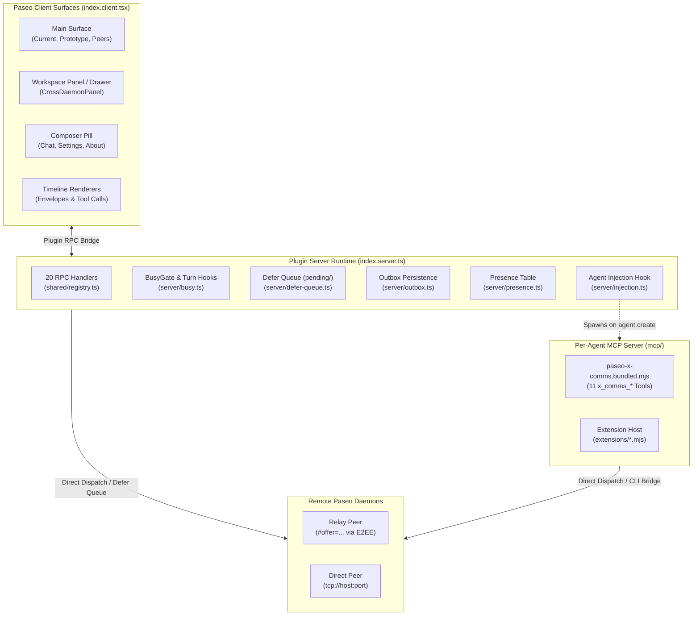
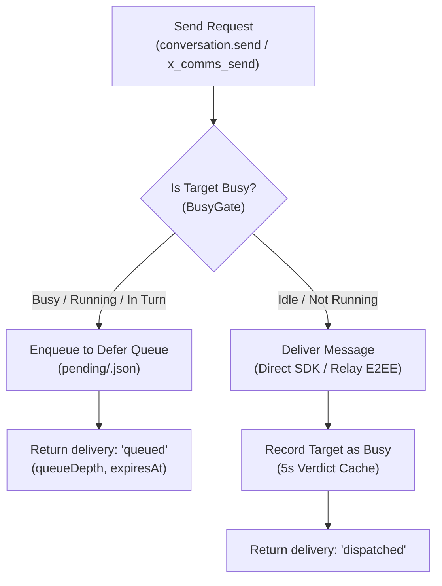

# x-comms Plugin & Surfaces Specification

> **Specification Authority:** Empirical Implementation as of Paseo >= 0.9.0 / Plugin v0.3.3  
> **Status:** Current State Baseline (for Operator Review & Planned Overhaul)  
> **Target Tracking Issue:** [#1483](https://forge.mrs.uppidi.com/xpufx-org/paseo/issues/1483) · Predecessor Architectures: [#706](https://forge.mrs.uppidi.com/xpufx-org/paseo/issues/706), [#840](https://forge.mrs.uppidi.com/xpufx-org/paseo/issues/840), [#842](https://forge.mrs.uppidi.com/xpufx-org/paseo/issues/842), [#1367](https://forge.mrs.uppidi.com/xpufx-org/paseo/issues/1367)  
> **Companion Documents:** [`docs/contract-plugin.md`](docs/contract-plugin.md) · [`docs/contract-mcp.md`](docs/contract-mcp.md) · [`docs/contract-evolution.md`](docs/contract-evolution.md) · [`docs/contract-drift.md`](docs/contract-drift.md) · [`docs/mesh.md`](docs/mesh.md)

---

## 1. Overview & Architectural Role

### 1.1 Purpose and Boundaries
The `x-comms` plugin enables multi-agent, cross-daemon communication across independent Paseo daemon hosts. It establishes a peer-to-peer messaging mesh for AI coding agents and human operators under a single owner.

* **Single-Owner Scope:** Links an individual operator's daemons through one client UI and agent runtime. Daemons belong to the same trust realm; stranger federation is explicitly out of scope.
* **Dual Deliverables:**
  1. **Paseo Plugin:** Full UI surface integration (`client/`), server-side event monitoring and RPC subsystem (`server/`), background queue workers, and automated agent MCP server injection.
  2. **Standalone MCP Server:** Stdio Model Context Protocol (MCP) server (`mcp/paseo-x-comms.mjs` and pre-bundled `paseo-x-comms.bundled.mjs`) usable standalone or embedded by the plugin.
* **Transports:** Supports two transport modes:
  * **Paseo Relay (E2EE):** Encapsulated WebSocket connection using `@getpaseo/relay/e2ee` and `DaemonClientRelayE2eeTransport` over pairing offers (`https://app.paseo.sh/#offer=<b64>`).
  * **Direct TCP / Unix Socket:** Direct unencrypted or local transport via host/port (`host:port`, `tcp://...`, `unix://...`, bare port).



### 1.2 Baseline Architecture vs. Planned Overhaul
The codebase currently reflects an evolutionary state bridging pre-0.8 patterns with modern Paseo >=0.9 capabilities:
* **Current Implementation:** Features file-backed registry (`registry.json`), filesystem-based atomicity for queues (`pending/*.json` rename claims), periodic interval sweeps, and dual-layer sending (direct SDK + MCP stdio bridge). `registry.json` is the single authoritative local registry for registered daemons. Connected live daemons are discovered strictly at runtime in the client via Paseo client host primitives (`useOptionalHosts()`) and presented as registration/pairing candidates into `registry.json`.
* **Target Overhaul (Zero-Registry Mandate):** As outlined in issue #706, the upcoming overhaul will eliminate static on-disk registry files in favor of self-contained pairing URLs (`https://app.paseo.sh/#offer=...`), in-memory authenticated peer session pools, native WebSocket lifecycle event streaming, and native daemon-level schedule engines.

---

## 2. Surface Inventory & Client UX

The client surface is registered through `index.client.tsx` using `paseo-plugin-helper` lifecycle primitives.

### 2.1 Surface Contributions Summary
| Surface Contribution | Implementation File | Mounting & Registration Point | Primary Function |
|---|---|---|---|
| **Main Surface** | `client/main.tsx` | `registerSidebarSurface(client, { id: "main", icon: "PhoneOutgoing" })` | Central management hub for registered daemons, candidate pairing, health status, and debug dumping. |
| **Workspace Panel** | `client/x-comms-panel.tsx` | `client.addWorkspacePanel({ id: "x-comms", context: "agent" })` | Per-agent cross-daemon conversation panel/drawer. |
| **Composer Pill** | `client/x-comms-pill.tsx` | `registerComposerPill(client, { id: "x-comms" })` | Quick launcher pill in agent chat composer opening modal with Chat, Settings, and About tabs. |
| **Header Button** | `index.client.tsx` | `client.addHeaderButton(...)` | Workspace top-bar shortcut button linking directly to the main X-comms surface. |
| **Message Transformer** | `client/x-comms-timeline.tsx` | `client.addTimelineTransformer(crossDaemonTransformer)` | Intercepts `user_message` timeline events containing `<x-comms-message>` or `[x-comms]`. |
| **Message Renderer** | `client/x-comms-timeline.tsx` | `client.addTimelineRenderer(crossDaemonRenderer)` | Renders structured incoming/outgoing cards with sender badges and collapsible overflow. |
| **Outbox Notice Renderer** | `client/x-comms-timeline.tsx` | `client.addTimelineRenderer(outboxNoticeRenderer)` | Renders local timeline delivery failure notices (`x-comms-outbox-notice`). |
| **Tool Call Transformer** | `client/x-comms-tool-call.tsx` | `client.addTimelineTransformer(crossDaemonToolCallTransformer)` | Intercepts `tool_call` items prefixed with `x_comms_*` or `paseo_cross_daemon_*`. |
| **Tool Call Renderer** | `client/x-comms-tool-call.tsx` | `client.addTimelineRenderer(crossDaemonToolCallRenderer)` | Renders tool execution cards, peer badges, status indicators, and truncated JSON outputs. |

---

### 2.2 Main Surface (`client/main.tsx`)
Rendered under three primary tabs: **Current**, **Prototype**, and **Peers**.

```
+------------------------------------------------------------------------+
| [ Current ]   [ Prototype (new) ]   [ Peers ]                          |
+------------------------------------------------------------------------+
| Server: Bundled server [~/.paseo/.../paseo-x-comms.bundled.mjs]       |
| Registry: ~/.paseo/plugin-data/xpufx/paseo-x-comms/registry.json       |
|                                                                        |
| Registered Daemons (2)                                                 |
| +--------------------------------------------------------------------+ |
| | home @ srv_8a12   [Reachable (4 agents)] [paired]                  | |
| | Host: https://app.paseo.sh/#offer=...                              | |
| | [ Probe ]   [ Edit ]   [ Debug ]   [ Remove ]                      | |
| +--------------------------------------------------------------------+ |
|                                                                        |
| Discovered Hosts (1)                                                   |
| +--------------------------------------------------------------------+ |
| | lab-box @ srv_3f90   [discovered (not paired)]                     | |
| | Server ID: srv_3f90                                                 | |
| | Status: online                                                      | |
| | [ Pair this host ]                                                  | |
| +--------------------------------------------------------------------+ |
|                                                                        |
| Add Daemon                                                             |
| Name: [ office               ]                                         |
| Host: [ 10.0.0.5:6767        ]                                         |
| [ Add daemon ]  [ Add anyway ]                                         |
+------------------------------------------------------------------------+
```

#### 2.2.1 Registered Daemons List
* Reads daemon records via `registry.read` RPC strictly from `registry.json` (the single authoritative local registry).
* Distinguishes registered daemons from discovered client host candidates (which are discovered strictly at runtime via `useOptionalHosts()`).
* **Live Health Badge (`HealthBadge`):**
  * `reachable (N agents)` (variant: `success`, green dot).
  * `unreachable` (variant: `danger`, red dot) with expandable error details.
  * `checking…` (variant: `neutral`, gray dot).
* **Daemon Actions:**
  * **Probe:** Triggers `daemon.probe` to test reachability on demand.
  * **Edit:** Inlines an edit form with live pre-save reachability testing.
  * **Debug:** Opens a slide-out/modal with a detailed daemon snapshot (`daemon.dump`).
  * **Remove:** Opens a confirmation modal invoking `daemon.remove` on `registry.json`.

#### 2.2.2 "Add Anyway" and "Save Anyway" Flow (#1367 / #1479)
To prevent blocking operators when adding remote or temporarily offline daemons:
* **Add Daemon Form:**
  * Clicking **Add daemon** executes a reachability probe first.
  * If the probe succeeds, the daemon is saved immediately.
  * If the probe fails, the error is displayed alongside an **Add anyway** button (`variant="danger"`), allowing forced persistence.
  * If valid inputs are entered, a secondary **Add anyway** button is available immediately without waiting for probe failure.
* **Edit Daemon Form:**
  * Editing a host address triggers a pre-save probe. If unreachable, a **Save anyway** button (`variant="danger"`) is displayed.

#### 2.2.3 Candidate Pairing Modal (`Pair Candidate Modal`)
* Hosts discovered via Paseo's live client host primitives (`useOptionalHosts()`) that are not yet paired are rendered under **Discovered hosts** with badge `discovered (not paired)` (`isPaired: false`).
* Clicking **Pair this host** opens the candidate pairing modal:
  * Prompts for the pairing offer URL (`https://app.paseo.sh/#offer=...`) or raw token.
  * **Validate & Pair:** Executes `daemon.probe` to verify the token/offer format and reachability. Upon validation, persists the peer into `registry.json` via `daemon.add` with `isPaired: true`, moving it into the primary Registered Daemons list.

#### 2.2.4 Introduce Agents Picker
* Multi-agent introduction modal allowing the operator to select Agent 1 and Agent 2 across any reachable daemons.
* Surface target gating (#842): Verifies both candidate daemons are resolvable and paired before dispatching introductions. Unresolvable daemons are flagged as `unconfigured`.
* Invokes `agents.introduce` RPC, generating mutual introductory prompt envelopes with return addresses.

#### 2.2.5 Debug Dump Modal
* Triggered via the **Debug** button on any daemon card.
* Invokes `daemon.dump` RPC and displays:
  * Transport (`relay` vs `direct`), Server ID, Hostname, Version, Listen address, PID, Started at.
  * Relay endpoints and configuration state.
  * Features and capabilities flags.
  * Agents inventory: status, name, short ID, provider, model, archived state, cwd.
  * Workspaces, projects, providers status, schedules, and active terminals.

---

### 2.3 Peers Status Surface (`client/peer-status.tsx`)
The **Peers** tab provides a real-time cluster status view:
* Polls every 30 seconds (`PEER_STATUS_POLL_MS = 30_000`) via `peer.status` RPC.
* Directly dials each daemon concurrently using `@getpaseo/client` `DaemonClient` over `DaemonClientRelayE2eeTransport` or direct TCP.
* **Per-Peer Diagnostics Rendered:**
  * **Reachability Badge:** `up` (green dot), `down` (red dot), or `invalid` (yellow dot).
  * **Plugin Presence Badge:** Displays `x-comms missing` (warning badge) if the remote daemon is reachable but does not have `x-comms` installed (`xCommsInstalled === false`).
  * **Network Identity:** `transport` (`relay` | `direct` | `unknown`), `serverId`, `hostname`, `version`, `pid`, `listen` socket/address.
  * **Relay State:** Enabled/disabled, active relay WebSocket endpoint.
  * **Provider Readiness:** Number of operational LLM providers vs total (`X/Y available`).
  * **Hub Connectivity:** `hubState`, `hubDaemonId`, `hubOrigin`, and `hubLastError`.

---

### 2.4 Composer Pill & Settings (`client/x-comms-pill.tsx`)
Registered into Paseo's agent composer bar via `registerComposerPill`:
* Opens centered modal with three tabs:
  1. **Chat:** Renders `CrossDaemonConversation` scoped to the current active agent.
  2. **Settings (`XCommsSettings`):**
     * **Presence Toggle:** Enables/disables local birth/retract broadcasts (`presenceEnabled`).
     * **MCP Injection Toggle:** Enables/disables auto-injection of `x-comms_*` tools for newborn agents (`injectionEnabled`).
     * Note: Changes require plugin reload to take effect.
  3. **About (`AboutSection`):** Displays plugin version, description, and repository metadata.

---

### 2.5 Agent Conversation Drawer / Panel (`client/x-comms-conversation.tsx`)
The primary conversation interface mounted in the agent workspace panel (`client/x-comms-panel.tsx`) and composer pill modal:
* **Thread Organization:** Derives bidirectional conversation threads (`deriveConversationThreads`) from local agent timeline messages and sent-message caches.
* **Target Selection:** Picker modal populated by `agents.introspect` (for registered daemons and their project/workspace/agent hierarchy, gated by `isSurfaceTargetResolvable`) and discovered candidates (rendered from `useDiscoveredHostCandidates()` with guidance that registration in `registry.json` is required to message them).
* **Unverified Sender Warning:** Unauthenticated or unsigned incoming envelopes display prominent notice banners: `[INCOMING · UNVERIFIED SENDER]`.
* **Sticky Bottom ScrollView (`StickBottomScrollView`):** Automatically tracks scroll height and maintains pin-to-bottom behavior during message stream updates, re-arming on thread switch.
* **Delivery Feedback & Lifecycle Badges:**
  * `dispatched`: Sent immediately to an idle agent.
  * `queued`: Target was busy; held in defer queue with queue position (`queueDepth`) and expiration timestamp (`expiresAt`).
  * `outbox`: Transport failed; held in outbox for exponential backoff retries.
  * `dropped`: Bound exceeded or target unresolvable; send rejected.

---

### 2.6 Timeline Transformers and Renderers
Registered in `index.client.tsx` to integrate seamlessly into Paseo core timelines:

#### 2.6.1 Message Envelope Renderer (`client/x-comms-timeline.tsx`)
* **Transformer (`crossDaemonTransformer`):** Scans all incoming `user_message` events. When text begins with `<x-comms-message>` (v6) or `[x-comms] ` (v5), parses the JSON payload into an `x-comms-message` plugin item.
* **Renderer (`crossDaemonRenderer`):**
  * **Header:** Icon (`PhoneIncoming` vs `PhoneOutgoing`), direction indicator (`Incoming` vs `Outgoing`), and peer label (`agentName @ alias (srv_...)`).
  * **Color Signal:** User-sent messages render danger/accent; peer and agent arrivals render neutral.
  * **Body:** Collapsible preview limited to 3 lines (`COLLAPSED_LINES = 3`). Messages exceeding 3 lines render a **Show more** / **Less** toggle and a quick copy button (`⧉`).
  * **Attribution Footer:** Appends `via x-comms` badge (`client/via-x-comms.tsx`).

#### 2.6.2 Outbox Failure Notice (`OutboxNoticeCard`)
* Renders `x-comms-outbox-notice` items emitted when messages expire after maximum retry attempts in the outbox. Displays warning icon and explicit failure reason.

#### 2.6.3 Tool Call Card (`client/x-comms-tool-call.tsx`)
* **Transformer (`crossDaemonToolCallTransformer`):** Intercepts `tool_call` timeline records matching prefix `x_comms_*` (and legacy `paseo_cross_daemon_*`).
* **Renderer (`crossDaemonToolCallRenderer`):** Replaces raw JSON timeline blocks with a formatted tool card featuring tool title, short target agent ID, status dot (`running`, `completed`, `failed`), peer display name, and syntax-highlighted, copyable JSON code block (max height 220px).

---

## 3. Server Subsystem & RPC Inventory

The server lifecycle is managed in `index.server.ts`, with handler logic in `server/handlers.ts`, `server/peer-status.ts`, and `server/injection.ts`. Persistent storage isolation is strictly enforced via `installStorageGuard({ pluginId: "x-comms" })`.

### 3.1 Server RPC Inventory (All 20 RPC Contracts)
Defined via Zod schemas in `shared/registry.ts`:

| # | RPC Name | Method Identifier | Input Contract (Zod) | Output Contract (Zod) | Execution Mode & Dependencies |
|---|---|---|---|---|---|
| **1** | `registry.read` | `registryReadRpc` | `{}` | `{ registryPath: string, exists: boolean, validJson: boolean, parseError: string \| null, daemons: Array<{ name, value, valid, error, source?, serverId, hostname, isPaired?, xCommsInstalled? }> }` | Local FS. Reads `registry.json` (single authoritative local registry). Validates every host form, derives `serverId` and hostname mappings, and tags daemons with `source: "registry"` and `isPaired: true`. Never throws. |
| **2** | `daemon.add` | `daemonAddRpc` | `{ name: string (1-64), value: string (1-512) }` | `{ saved: boolean, error: string \| null, registryPath: string, daemons: DaemonEntry[], pairingToken?: string \| null }` | Local FS (`0600`). Operates strictly on `registry.json`. Validates charset `^[A-Za-z0-9._-]+$`, rejects duplicates and duplicate host values. |
| **3** | `daemon.update` | `daemonUpdateRpc` | `{ name: string (1-64), rename?: string (1-64), value?: string (1-512) }` | `{ saved: boolean, error: string \| null, registryPath: string, daemons: DaemonEntry[] }` | Local FS (`0600`). Operates strictly on `registry.json`. Atomic rename or re-addressing. Validates new host format. |
| **4** | `daemon.remove` | `daemonRemoveRpc` | `{ name: string (1-64) }` | `{ saved: boolean, error: string \| null, registryPath: string, daemons: DaemonEntry[] }` | Local FS. Operates strictly on `registry.json`. Deletes entry; returns `saved: false` and error if daemon does not exist. |
| **5** | `daemon.health` | `daemonHealthRpc` | `{}` | `{ results: Array<{ name: string, reachable: boolean, error: string \| null, agentCount: number \| null }> }` | Peer probe. Returns 60s cached reachability verdicts; kicks immediate outbox retry on reconnect. |
| **6** | `peer.status` | `peerStatusRpc` | `{}` | `{ results: Array<{ name, value, valid, reachable, error, transport, serverId, hostname, version, pid, listen, relayEnabled, relayEndpoint, providerCount, providersAvailable, hubState, hubDaemonId, hubOrigin, hubLastError, xCommsInstalled? }> }` | Live peer probe. Dials every peer concurrently via `DaemonClient` (`daemon.get_status`, `getHubStatus`). |
| **7** | `server.status` | `serverStatusRpc` | `{}` | `{ installPath: string, installed: boolean, configured: boolean, version: string \| null, syntaxOk: boolean, error: string \| null }` | Local FS. Locates bundled MCP server script and parses version metadata. |
| **8** | `agents.introspect` | `introspectAgentsRpc` | `{}` | `{ daemons: Array<{ name: string, reachable: boolean, error: string \| null, projects: Array<{ project: string, workspaces: Array<{ name: string, agents: Array<{ agentId, shortId, name, status }> }> }> }> }` | Peer queries. Iterates all registered daemons in `registry.json` and builds project/workspace/agent hierarchy tree. |
| **9** | `agents.introduce` | `introduceAgentsRpc` | `{ first: { daemon, agentId, shortId, name }, second: { daemon, agentId, shortId, name }, message: string (1-4000) }` | `{ sends: Array<{ daemon: string, agentId: string, ok: boolean, error: string \| null }>, refused?: boolean, refusalReason?: string \| null }` | Peer send. Formulates mutual introduction prompts with return addresses; gates against unpaired/unresolvable daemons. |
| **10** | `daemon.probe` | `daemonProbeRpc` | `{ value: string (1-512) }` | `{ valid: boolean, formatError: string \| null, reachable: boolean, error: string \| null }` | Peer network probe. Validates host format and executes live connect with 8s dial timeout. |
| **11** | `ui.prefs.get` | `uiPrefsGetRpc` | `{}` | `{ prereqsCollapsed: boolean, presenceEnabled: boolean, injectionEnabled: boolean, outboxExpirySeconds?: number, daemonEnabled?: Record<string, boolean> }` | Local FS (`plugin.json`). Loads user UI preferences with fallback defaults. |
| **12** | `ui.prefs.set` | `uiPrefsSetRpc` | `{ prereqsCollapsed: boolean, presenceEnabled?: boolean, injectionEnabled?: boolean, outboxExpirySeconds?: number, daemonEnabled?: Record<string, boolean> }` | Local FS (`plugin.json`). Merges partial configuration updates atomically. |
| **13** | `snapshot.refresh` | `snapshotRefreshRpc` | `{}` | `{ updatedAt: string }` | Peer + FS. Probes whole fleet and reconciles local agent timelines into `conversations.json`. |
| **14** | `daemon.dump` | `daemonDumpRpc` | `{ daemon: string }` | Detailed record: ~30 fields (identity, listen, transport, agents, workspaces, projects, providers, schedules, terminals, permissions=[]) | Peer diagnostic. Executes parallel daemon diagnostic inspection behind 20s wrappers. |
| **15** | `identity.sync` | `identitySyncRpc` | `{}` | `{ identities: Record<string, string>, hostnames: Record<string, string> }` | Local decode. Re-derives `serverId` and hostname mappings from pairing offers and cached metadata. |
| **16** | `presence.announce` | `presenceAnnounceRpc` | `{ messageId: string, entries: PresenceBirth[] (<=500) }` | `{ accepted: number, rejected: number }` | Peer control plane. Ingests remote agent birth records into local presence table with anti-loop checks. |
| **17** | `presence.retract` | `presenceRetractRpc` | `{ messageId: string, serverId: string, agentId: string, timestamp: string }` | `{ applied: boolean }` | Peer control plane. Ingests agent retract tombstones and prunes matching conversation threads. |
| **18** | `presence.list` | `presenceListRpc` | `{}` | `{ live: PresenceBirth[], tombstones: PresenceTombstone[], pendingRetracts: number }` | Local FS. Sweeps expired TTLs and returns current mesh presence state. |
| **19** | `conversation.send` | `conversationSendRpc` | `{ daemon: string, agentId: string, prompt: string, fromAgentId?: string \| null, fromAgentName?: string \| null, messageId?: string (1-128), notifyOnFinish?: boolean, stamped?: boolean }` | `{ daemon: string, agentId: string, ok: boolean, error: string \| null, delivery?: "dispatched" \| "queued" \| "outbox" \| "dropped", queueDepth?: number, expiresAt?: string \| null, refused?: boolean, refusalReason?: string \| null }` | Core Send Gate. Evaluates busy gate, delivers via native SDK or MCP/direct transport, or enqueues defer/outbox. |
| **20** | `mesh.key` *(Peer RPC)* & `directHostMismatch` | Internal / Peer Protocol | `mesh.key`: `{}` → `{ serverId: string \| null, keyId: string, publicKeyPem: string }`<br>`directHostMismatch`: `(name, value) => string \| null` | Key Exchange / Host Verification. `mesh.key` publishes daemon verify key; `directHostMismatch` validates custom alias visual identity (#1367). |

---

### 3.2 Daemon Event Hooks (`server/index.ts`)
The server subscribes to four daemon lifecycle events:
1. `agent.created`:
   * Captures `context.paseo` handle (`rememberPaseo`).
   * When `presenceEnabled` is true, registers a local presence birth and broadcasts `presence.announce` to all dialable, enabled peers. Piggybacks any queued retracts.
2. `agent.archived`:
   * Broadcasts `presence.retract` to all peers immediately; queues failed attempts for background retry.
   * Detaches the archived agent from `conversations.json`.
3. `agent.turn_started`:
   * Notes active turn in `BusyGate` (`noteLocalTurnStarted(agent.id)`).
   * Invalidates cached busy verdicts to guarantee fresh turn state.
4. `agent.turn_ended`:
   * Clears turn from `BusyGate`.
   * Triggers immediate targeted drain of the defer queue (`onLocalTurnEnded(agent.id)`), releasing held messages into the now-idle agent.

---

### 3.3 MCP Injection & Standing Recipient Instructions (`server/injection.ts`)
On `agent.create`, the server registers two non-mutating injection hooks:
1. **MCP Tool Injection:**
   * Injects the embedded MCP server into `config.mcpServers`.
   * **Key Scheme:** Strict underscore format: `x-comms_<serverId>` (fallback `x-comms`). Dotted keys (`x-comms.<id>`) are strictly forbidden to prevent ACP/Gemini JSON-RPC `-32602` initialization errors (#243).
   * **Binary Path:** Copies bundle to stable path `~/.paseo/plugin-data/xpufx/paseo-x-comms/bin/paseo-x-comms.bundled.mjs` via `syncStableServer()`.
   * **Environment:** Passes `PASEO_X_COMMS_MESH_KEY` pointing to local signing credentials.
2. **Standing Recipient Instructions Injection (`server/recipient-instructions.ts`):**
   * Appends envelope handling rules into `config.systemPrompt` under the marker `[x-comms-recipient]`.
   * Instructs recipient agents to treat `<x-comms-message>` envelopes as protocol deliveries, parse `sender`/`target`/`messageId`, attribute the remote sender, and reply via `x_comms_send`.

---

## 4. Embedded & Standalone MCP Server

The MCP server is implemented in `mcp/paseo-x-comms.mjs` and built via esbuild to `mcp/paseo-x-comms.bundled.mjs`.

### 4.1 Tool Inventory (11 Tools)

| Tool Name | Parameters | Returns | Operational Behavior |
|---|---|---|---|
| `x_comms_list_daemons` | `{ detailed?: boolean }` | `string[]` or `Array<{ name, target, status: "online", serverId, source: "registry" }>` | Lists registered daemons from `registry.json`. Returns names only by default, or detailed objects with `source: "registry"` when `detailed: true`. Targets are redacted (`#offer=[REDACTED]`). Does not ping. |
| `x_comms_add_daemon` | `{ name: string, offer: string }` | `{ ok: true, daemons: string[] }` | Operates strictly on `registry.json`. Appends entry and silently overwrites existing keys. |
| `x_comms_remove_daemon` | `{ name: string }` | `{ ok: true, daemons: string[] }` | Operates strictly on `registry.json`. Removes entry; throws error if daemon does not exist. |
| `x_comms_list_agents` | `{ daemon: string }` | Structured agent list JSON | Queries daemon via `DaemonClient.fetchAgents()` or `paseo ls --host`. |
| `x_comms_inspect` | `{ daemon: string, agentId: string }` | Agent metadata JSON | Reads agent status and configuration via `DaemonClient.inspectAgent()` or CLI. |
| `x_comms_send` | `{ daemon: string, agentId: string, prompt: string, fromAgentId?: string, fromAgentName?: string, messageId?: string, notifyOnFinish?: boolean }` | Daemon send response or `{ delivery: "queued", queueDepth, expiresAt }` | Stamps v6 envelope, probes target busy state, queues if mid-turn, dispatches if idle. Queues finish notice. |
| `x_comms_logs` | `{ daemon: string, agentId: string }` | Agent activity logs JSON | Retrieves agent activity records via `subscribeAgentTimeline()` or CLI logs. |
| `x_comms_wait` | `{ daemon: string, agentId: string, timeoutSeconds?: number }` | `{ status: "idle" \| "permission" \| "timeout" }` | Waits for turn completion or returns immediately on interactive permission block. |
| `x_comms_list_permissions` | `{ daemon: string }` | Pending permissions array | Queries active tool approvals pending operator confirmation. |
| `x_comms_allow_permission` | `{ daemon: string, agentId: string, reqId?: string, all?: boolean, input?: unknown }` | Confirmation JSON | Approves pending tool approval via `DaemonClient.respondToPermission()` or CLI permit. |
| `x_comms_deny_permission` | `{ daemon: string, agentId: string, reqId?: string, all?: boolean, message?: string, interrupt?: boolean }` | Confirmation JSON | Rejects pending tool approval with optional explanation. |

---

### 4.2 Server Capabilities & Execution Model (C1 - C14)
Beyond the 11 tools, the MCP runtime incorporates 14 critical capabilities:
* **C1 · Envelope Stamping:** Automatically prepends `<x-comms-message>{"xComms":{...}}</x-comms-message>\n\n` before the user's prompt text.
* **C2 · Sender Identity Resolution:** Resolves sender metadata from daemon-injected environment variables (`PASEO_AGENT_ID`, `PASEO_AGENT_CWD`) and daemon status. In an agent session, any caller-provided `fromAgentId` is discarded to prevent spoofing (#594).
* **C3 · Self-Message Guard:** Prevents agents from sending messages to themselves, rejecting with `x-comms self-message: target agentId '<id>' is your own agent`.
* **C4 · Busy Gate:** Evaluates target run state before dispatching. Mid-turn agents cause messages to be held in the defer queue.
* **C5 · Defer Queue Integration:** Shares the filesystem queue in `<registry_dir>/pending/` with the plugin server.
* **C6 · Delivery Notices:** Enqueues completion notices back to the sender (`notifyOnFinish: true`) through the defer queue without preempting the sender's turn.
* **C7 · Registry I/O:** Reads/writes `registry.json` as the single authoritative local registry for registered daemons.
* **C8 · Unified Client Host Discovery (Client Surfaces):** Connected live daemons are discovered strictly at runtime in the client via Paseo client host primitives (`useOptionalHosts()`) and presented as registration/pairing candidates into `registry.json`.
* **C9 · Unknown-Daemon Diagnostic:** Provides descriptive guidance for missing registry keys, advertising both direct host and relay routes.
* **C10 · Offer & Secret Redaction:** Redacts `#offer=...` tokens in tool returns and scrubs Bearer tokens and passwords from logs/errors (`redactSecrets`).
* **C11 · Extension Host:** Dynamically loads trusted JavaScript extension plugins from `~/.paseo/plugin-data/xpufx/paseo-x-comms/extensions/*.mjs`.
* **C12 · Process Execution & Cancellation:** Executes external calls with abort signal propagation, killing child subprocesses on client cancellation.
* **C13 · Result Envelope:** Standardizes MCP `content` blocks and `structuredContent` objects.
* **C14 · Instructions Handshake:** Advertises envelope syntax and non-preemption delivery rules via MCP protocol `instructions`.

---

## 5. Shared Wire Substrate & Wire Contract

### 5.1 Wire Envelope Schema (Version 6)
Every message transmitted across daemons prepends a machine-readable JSON block delimited by XML tags:

```
<x-comms-message>{"xComms":{"version":6,"type":"x-comms.message","direction":"outgoing","sender":{"agentId":"...","agentName":"...","host":"...","daemonServerId":"...","cwd":"..."},"target":{"daemon":"...","agentId":"..."},"messageId":"...","sentAt":"2026-10-20T08:44:13Z"}}</x-comms-message>

User prompt text begins here after double newline...
```

#### Envelope Fields Specification
| Field | Type | Description |
|---|---|---|
| `version` | `number` | Wire format version. Current format is **6**. |
| `type` | `"x-comms.message"` | Protocol discriminator string. |
| `direction` | `"outgoing"` | Always stamped `"outgoing"` by the sender. Viewers compute relative direction by comparing `sender.agentId` to their own agent ID. |
| `sender.agentId` | `string \| null` | UUID of sending agent session. |
| `sender.agentName` | `string \| null` | Human-readable name of sending agent. |
| `sender.host` | `string \| null` | Hostname or address of sending daemon. |
| `sender.daemonServerId` | `string \| null` | Unique server ID (`srv_...`) of sending daemon. |
| `sender.cwd` | `string \| null` | Working directory of sending agent. |
| `target.daemon` | `string \| null` | Target daemon alias or server ID. |
| `target.agentId` | `string \| null` | Target agent UUID. |
| `messageId` | `string` (1-128, optional) | Daemon idempotency delivery key (UUID). Preserved across retries to prevent duplicate turn dispatch. |
| `sentAt` | `string` (ISO 8601) | Timestamp when message was stamped and signed. |

#### Dual-Parser Compatibility
`parseEnvelope` (`shared/envelope.ts`) dual-parses:
1. **Version 6 (Canonical):** Enclosed in `<x-comms-message>...</x-comms-message>`.
2. **Version 5 (Legacy):** Prefixed with `[x-comms] {"xComms":{...}}\n\n`.

---

### 5.2 Busy Gate & Anti-Preemption Rule
Paseo daemons dispatch turn prompts with `replaceRunning: true`. Sending to an active agent will abort and replace its active turn. The Busy Gate prevents preemption:



* **Busy Status Deny-List:** `initializing`, `running`, `busy`, `permission`, `awaiting_permission`, `waiting_permission`.
* **Non-Busy States:** `idle`. Note that `error` and `closed` are explicitly non-busy to avoid indefinitely queueing messages against terminated agents.
* **Verdict Cache:** Cached for 5 seconds (`DEFER_VERDICT_TTL_MS = 5_000`). After dispatch, the target is marked busy immediately to prevent burst-send preemption.
* **Fail-Open Policy:** If reachability probing errors out, the gate fails open to dispatch rather than silently swallowing messages. Unresolvable aliases, however, fail closed (#842).

---

### 5.3 Defer Queue Subsystem (`server/defer-queue.ts`)
* **Storage Location:** `<plugin-data>/pending/`.
* **Atomic Claim Protocol:**
  * Waiting items: `<uuid>.json`.
  * Claimed items: Atomically renamed to `<uuid>.sending`. Only one worker can claim an item.
* **Dead Worker Guard:** Stale `.sending` files remaining at the beginning of a pass indicate a crashed process; they are logged as *outcome unknown* and purged rather than replayed.
* **Backlog Bounds:**
  * **Per-Target Limit:** Maximum 8 items (`DEFER_MAX_DEPTH_PER_TARGET = 8`). Overflow evicts the oldest item and notifies the sender.
  * **Fleet-Wide Limit:** Maximum 200 items (`DEFER_MAX_TOTAL = 200`). New arrivals beyond the ceiling are refused (`delivery: "dropped"`).
  * **Expiration Window:** 30 minutes (`DEFER_EXPIRY_MS = 1_800_000`).
* **Drain Workers:** Drained via 15-second timer sweeps and triggered immediately upon `agent.turn_ended`.

---

### 5.4 Outbox Persistence & Retry Subsystem (`server/outbox.ts`)
Handles network/transport failures (e.g., peer offline, relay disconnect):
* **Storage File:** `~/.paseo/plugin-data/xpufx/paseo-x-comms/outbox.json`.
* **Exponential Backoff:** Base 5 seconds doubling up to 60 seconds (`outboxBackoffMs(attempts)`).
* **Retry Sweeps:** Periodic pass every 15 seconds (`OUTBOX_POLL_INTERVAL_MS = 15_000`), plus immediate retries triggered whenever a daemon reconnects (`false → true` reachability transition in `daemon.health`).
* **Expiry Window:** Default 10 minutes (600 seconds), configurable up to 24 hours. Expired messages append an `x-comms-outbox-notice` card to the sender's local timeline.
* **Idempotency:** Reuses the original `messageId` across all retries to ensure the remote daemon discards replayed duplicates.

---

## 6. Data Storage & File Layout

All persistent plugin state is isolated under the scoped directory:
`~/.paseo/plugin-data/xpufx/paseo-x-comms/` (overridable via `PASEO_X_COMMS_REMOTES`).

```
~/.paseo/plugin-data/xpufx/paseo-x-comms/
├── registry.json                 # Authoritative daemon registry (JSON, mode 0600)
├── plugin.json                   # UI preferences and toggles
├── outbox.json                   # Outbox entries awaiting transport retry
├── presence.json                 # Fleet presence entries, tombstones, and LRU
├── conversations.json            # Cached thread snapshots for cross-plugin consumers
├── snapshot.json                 # Cached fleet reachability probe snapshot
├── bin/
│   └── paseo-x-comms.bundled.mjs # Stable bundled MCP server executable
├── extensions/                   # Unsandboxed server extensions (*.mjs)
└── pending/                      # Defer queue items
    ├── 17f0...b4a1.json          # Waiting message file
    └── 8e2b...091c.sending       # Claimed message file actively dispatching
```

### Storage Files Inventory
| File Path | Schema & Purpose | Permissions & Access Policy |
|---|---|---|
| `registry.json` | `{ [daemonName: string]: string }` — Maps daemon aliases to opaque `--host` URLs or pairing offers. | Mode `0600`. Treated as sensitive credentials. Single authoritative local registry for registered daemons. |
| `plugin.json` | Preferences object: `prereqsCollapsed`, `presenceEnabled`, `injectionEnabled`, `outboxExpirySeconds`, `daemonEnabled`. | Managed via `PluginStorage`. Tolerates corrupt JSON by falling back to defaults. |
| `outbox.json` | Array of `OutboxEntry` records tracking undelivered messages, retry counts, and next attempt timestamps. | Read-modify-write serialised via `withOutboxLock`. |
| `presence.json` | Stores live agent announcements, tombstones (kept 14 days), seen message IDs (LRU cap 1000), and queued retracts. | Managed via `PluginStorage`. |
| `conversations.json` | Serialized summary of top 200 cross-daemon conversation threads with unread counts. | Capped at 200 items; updated during `snapshot.refresh`. |
| `pending/` | Directory holding individual defer queue JSON files. | One file per queue item to avoid cross-process locking overhead. |
| `bin/paseo-x-comms.bundled.mjs` | Bundled standalone MCP server runtime. | Synchronized on plugin startup to provide stable executable path. |

---

## 7. Testing & Verification

The plugin codebase enforces high test determinism and regression tracking across Node's native test runner and Vitest.

### 7.1 Test Suites Structure
* **Server & Protocol Tests (Node `--test`):**
  * `index.server.test.ts`: Verifies entrypoint lifecycle, storage guard installation, and RPC registration.
  * `instruction-surfaces.test.ts`: Enforces parity across recipient instructions, skill documentation, and MCP `instructions`.
  * `server/storage-guard.test.ts`: Verifies storage directory isolation and legacy cleanup.
  * `server/busy.test.ts`: Tests `BusyGate` deny-list classification, caching, and fail-open behaviors.
  * `server/defer-queue.test.ts`: Tests queue depth bounds, eviction of oldest items, and atomic `.sending` file claims.
  * `server/outbox.test.ts`: Tests exponential backoff arithmetic, retry loops, and expiry notices.
  * `server/presence.test.ts`: Tests presence birth batches, sticky tombstones, and anti-loop LRU filters.
  * `server/injection.test.ts`: Asserts sanitized `x-comms_<serverId>` MCP server key naming and system prompt wiring.
  * `server/peer-status.test.ts`: Validates concurrent `DaemonClient` live status probing.
  * `server/unknown-daemon.test.ts`: Validates diagnostic error strings for missing daemons.
* **Client & UI Tests (Node `--test` & Vitest):**
  * `client/conversation-send.test.ts`: Tests defer gate status reporting in conversation drawer.
  * `client/conversation-threads.test.ts`: Validates conversation thread derivation from dual v5/v6 envelopes.
  * `client/surface-target.test.ts`: Verifies target resolution and unconfigured daemon warnings (#842).
  * `client/configured-hosts.test.ts`: Tests host discovery and candidate handling.
  * `client/message-direction.test.ts`: Verifies red user-sent vs neutral peer message signals.
  * `client/ui-guard.palette.test.tsx` (Vitest): Verifies strict palette compliance with host theme.
* **MCP Protocol Tests (`mcp/test/`):**
  * `mcp/test/protocol.test.mjs`: Tests MCP JSON-RPC compliance for all 11 tools.
  * `mcp/test/bundle-reproducible.test.mjs`: Byte-identity assertion verifying `paseo-x-comms.bundled.mjs` matches unbundled source.
  * `mcp/test/redaction-parity.test.mjs`: Asserts parity of secret redaction between standalone MCP server and plugin helper.
  * `mcp/test/relay-offer-redaction.test.mjs`: Asserts `#offer=` tokens are redacted from tool outputs.

### 7.2 Verification Execution Commands
```bash
# Typecheck TypeScript definitions
npm --prefix plugins/x-comms run typecheck

# Run complete hermetic test suites
npm --prefix plugins/x-comms test
```
All suites run hermetically without requiring live network connections or production daemon access.
